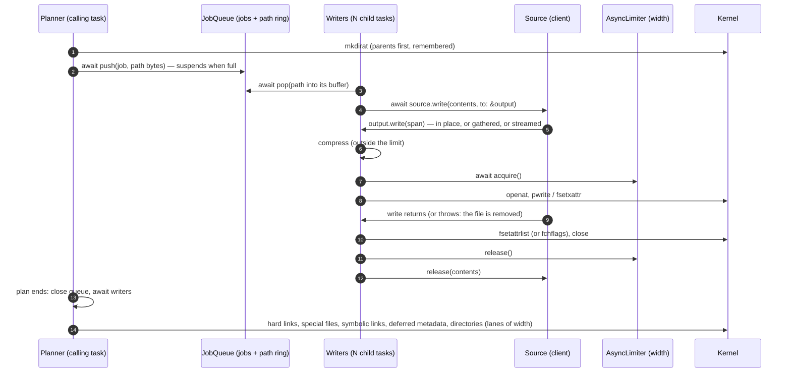

# How Disk writes a tree

Disk is the disk-writing half of NativeAEA and NativeZipArchive, extracted: a destination opened once, entries made
relative to it with the kernel refusing anything that leaves it, APFS transparent compression as Apple's extractors
write it, and a scheduler that keeps CPU work outside a small file-system limit. Its clients are archive readers
(NativeAEA's walkers, NativeZip's planner) and an app (Nunarchiver). The measurements behind each choice are in
[RESULTS.md](RESULTS.md); the lessons it inherits are in the repository's AGENTS.md and NativeAEA's
[ARCHITECTURE.md](../NativeAEA/ARCHITECTURE.md), whose extraction this generalizes.

All paths below are under `Sources/Disk/`.

## 1. The layers

| Layer | Types | For |
|---|---|---|
| Paths | `EntryPath` (`EntryPath.swift`) | A checked, canonical relative path: a `~Escapable` view of the caller's bytes |
| Destination | `Destination`, `DestinationOptions` (`Destination.swift`) | The directory, the policies, and every entry primitive, synchronous |
| Metadata | `EntryMetadata`, `EntryTimes`, `Owner`, `Quarantine`, `ExtendedAttributeBlob`, `AttributeList` (`Metadata.swift`) | Mode, owner, times, and flags in one call; xattr and ACL blobs |
| APFS compression | `Storage`, `StoragePolicy`, `DiskCodec`, `ChunkEncoders`, `ForkUnpacker` (`Decmpfs.swift`) | `decmpfs` forms and Apple's storage rules; the chunks' codecs through BytesCompression's `Compressor` and `Decompressor` (`DiskCodec.compressionFormat`, `.decompressionFormat`: BytesCompression/ARCHITECTURE.md §1) |
| One file | `FileWriter`, `WriterCore` (`FileWriter.swift`) | Compress, then make: the steps every writer runs |
| The scheduler | `Extraction`, `Planner`, `ContentSource`/`PieceSource`, `FileOutput`, `ExtractionSettings`, `ExtractionReport`, `ExtractionProgress` (`Extraction.swift`, `Planner.swift`, `Writer.swift`, `PostPasses.swift`, `Sources.swift`, `Progress.swift`) | A whole tree, in parallel |
| Single files | `MappedFile`, `OutputFile` (`Files.swift`) | Outside a destination: the archive a client reads, mapped; one file written at the caller's path |
| Primitives | `JobQueue` (`JobQueue.swift`); BytesAsync's `AsyncLimiter`, `AsyncIndexPool`, `AsyncLatch`, `WaiterQueue`, `Continuation`; Bytes' `RawStorage` | Waits as `Mutex` state plus a continuation; memory made once |
| Counting | `Sys`, `SyscallCounter` (`Syscalls.swift`) | Every file system call through one wrapper, counted with the `SyscallCounting` trait |

The waiting primitives and `RawStorage` were Disk's own until 2026-11-21 (and NativeAEA had the same ones): they're in
BytesAsync and Bytes now, used by Disk, NativeAEA, and NativeZip alike, inlined into each (no count changed:
RESULTS.md). Disk's write queue stays here: its path ring and low-water wake are this scheduler's.

## 2. Paths and the destination

`EntryPath(validating:)` accepts the empty path (the destination itself) or `component(/component)*` with no empty, `.`,
or `..` component, no NUL, under `PATH_MAX`. Checked once, with a vector screen (`ByteLanes`, 16 bytes a test: no NUL,
no `/` or `.` first, no `/` last, no `/` followed by `/` or `.`) that sends anything suspicious (dot files) to an exact
check. `EntryPath.sanitize` cleans a ZIP name the way Info-ZIP does (drops a leading `/` and `..` components and says
so), so lenient formats get a valid path before they get here.

`Destination(path, options:)` makes the directory if needed and opens it; every entry is then made relative to that
descriptor:

- **Files:** `openat(root, path, O_WRONLY | O_CREAT | O_EXCL | O_NOFOLLOW_ANY | O_RESOLVE_BENEATH, mode | 0600)`. No link
  anywhere in the path is followed (`ELOOP`), and the kernel refuses to resolve outside the destination
  (`ENOTCAPABLE`, macOS 27). `O_EXCL` means nothing is ever written through an existing link: an existing item is
  failed, skipped, or unlinked and made again (`ExistingItemPolicy`).
- **Directories** have no flag-taking `mkdirat`: the scheduler's planner makes each parent before its contents and
  remembers it (`DirectoryTable`), checking any it didn't make with `fstatat(AT_SYMLINK_NOFOLLOW_ANY)`; a directory is
  made only under a parent this destination made or checked. A link where a directory goes is an error (or, with
  `.replace`, unlinked: replaced, never followed). A parent the archive doesn't list (ZIP archives often list none) is
  made 0755 less the umask on the way to its first entry and, with a quarantine, gets it at the end like everything
  else extracted (`DirectoryFix.quarantineOnly`: one `setxattr`, nothing without a quarantine). A directory the
  archive lists only after something made it, or that was there already, gets the entry's mode at the end whatever
  it has (`setsMode`); one the entry's own `mkdir` made is touched again only if something differs.
- **Symbolic links, FIFOs, devices** (`symlinkat`, `mkfifoat`, `mknodat` take no flags): in their parent, opened
  `O_NOFOLLOW_ANY | O_RESOLVE_BENEATH`, by name.
- **Hard links:** one `linkat(root, target, root, path, AT_SYMLINK_NOFOLLOW_ANY | AT_RESOLVE_BENEATH)`, and only to a
  file the plan wrote (`Planner.hardLink(_:to:)` takes the target's `EntryToken`).
- **Metadata by path:** `setattrlistat(… FSOPT_NOFOLLOW | FSOPT_NOFOLLOW_ANY)` on a link itself; the quarantine of a
  directory by its absolute path (`F_GETPATH` of the root, resolved) with `XATTR_NOFOLLOW_ANY`.

`DirectoryResolution.descriptors` opens each directory and makes its contents relative to it (one component per call);
`.paths` (default) names everything from the root. Every flag-taking call refuses links either way. The difference is
`mkdirat`: by path, it would follow a link in the parent, so `.paths` relies on the parent having been made or checked
earlier in the extraction; another process with write access to the destination could swap a checked directory for a
link in between and have one empty directory made where the link points (nothing written into it: file creation
refuses the link). `.descriptors` closes that window at the cost of an `open` and a descriptor per directory (equal
here, +3% for Xcode's 30,000 in NativeAEA; RESULTS.md).

`Destination.staging(for:)` makes `.NAME.partial-XXXXXX` beside the final name; `publish(as:uniquing:)` renames it into
place with `RENAME_EXCL` (`NAME 2`, `NAME 3` when taken, as the Finder names them) and `discard()` removes it
(`TreeRemoval`: descriptors, `O_NOFOLLOW`, flags and read-only modes cleared on the way). What an app shows the user
appears all at once, or not at all.

`publishUnwrapped(as:)` is Archive Utility's rule on top of that (measured against it, RESULTS.md 2026-11-21): a
staging directory holding exactly one item has that item renamed out beside it under its own name (`hello.txt`, then
`hello 2.txt`; a read-only directory is lent its owner's write bit for the rename, since its `..` changes) and is then
removed; anything else is published as the folder. The folder keeps the staging directory's 0700, as Archive Utility's
folders have, unless the plan had an entry for the root (`planner.directory` with the empty path: the destination
wasn't made with that entry's mode, so the directory pass sets it, with its times); it's quarantined when the
options say (`quarantinesDestination`, applied when the staging directory is made). `Destination.isCaseSensitive` is the volume's answer (`fpathconf`), for clients
that must know two names are one item (NativeZip's duplicate entries).

**Outside a destination** (`Files.swift`), two types for the files a client names itself, where the rules above
don't apply (the path is the caller's, links in it followed as `open` follows them):

- `MappedFile`: a read-only mapping of an archive (`mmap`, `MAP_PRIVATE`), its bytes at a stable address for the
  object's life: `bytes` is a `RawSpan` borrowing it, `buffer(_:)` a checked range for work that outlives a borrow
  (a decode loop across `await`s). `Access.sequential` adds `MADV_SEQUENTIAL`. It was NativeZip's `MappedFile` and
  NativeAEA's `RawMapping`; errors are the kernel's `Errno`, as both threw them. A mapped file someone else
  truncates faults on some volumes: on FAT and exFAT a read past the new end raises `SIGBUS` (675 of 676 pages, an
  exFAT image), while APFS and HFS+ keep the mapping's bytes, cold pages too (C probes, 2026-11-23). So `init(path:)`
  maps the file itself on APFS and HFS+ and, elsewhere, a private copy: `fcopyfile` into an unlinked temporary file
  on the internal volume (`Source.automatic`; `.file` and `.copy` force either). From a cold exFAT image the copy and
  its first pass took 94 ms for 256 MB against 137 ms of page faults on the file; cached, 131 against 12. A clone
  would cost nothing to make but has its own page cache (1.5 s against 46 ms for a cached gigabyte), and FAT has none.
  Removing the media under a mapping of an APFS volume's file presumably still faults (not tested): only reading
  instead of mapping would avoid that.
- `OutputFile`: one file created at a path (`O_EXCL`, or truncated when replacing), written with positioned writes
  to the end (`write(_:at:)`, the same loop the writers use), closed by `close()` (which reports `close`'s error:
  the last sign data didn't reach the disk): NativeAEA's decryption to a file.

## 3. Metadata, in order

| Step | Call | Why here |
|---|---|---|
| Create | `openat(…, (mode & 0777) | 0600)` | Owner-writable: `fsetxattr` checks the file's mode, not the descriptor's |
| Contents | `pwrite`, or `fsetxattr` of the fork and `com.apple.decmpfs` | |
| Quarantine | `fsetxattr(com.apple.quarantine)` | |
| Everything else | one `fsetattrlist`: creation, modification, access times, owner, group, mode, flags; or, flags alone, `fchflags` | One call instead of up to four, and the order lessons hold inside it (below) |
| Close | `close` | |

`fchflags(UF_COMPRESSED)` sets the modification time to now, and locking flags stop later calls, so NativeAEA set flags,
then times, then locking flags. Measured here (RESULTS.md, "one call"): a single `fsetattrlist` with
`ATTR_CMN_MODTIME | ATTR_CMN_ACCESSMASK | ATTR_CMN_FLAGS` keeps the times given, with `UF_COMPRESSED` and with
`UF_IMMUTABLE`, so a compressed file costs open, fork, header, attributes, close, and a plain file with times open,
write, attributes, close. The call is skipped when nothing differs from what `open` made. When flags are all there is
to set (a compressed file with no times, mode change, or owner: every file of Xcode's `.aea`), `fchflags` sets them:
62,000 kernel instructions less than `fsetattrlist` with only `ATTR_CMN_FLAGS`, and with no times to keep, its new
modification time is the one `open` gave anyway (`AttributeList.apply`; RESULTS.md, 2026-11-20 follow-ups).

Policies (`DestinationOptions`): the umask applied (read once with `getumask()`, never set) or the archived mode exact;
setuid, setgid, and sticky stripped unless kept; owners only as root and when asked; `SF_` flags only as root; devices
refused unless allowed; symbolic link targets anywhere or only inside (`SymbolicLinkPolicy`).

Files with extended attributes or an ACL (`attachments: true`), and hard-link targets with locking flags, are left
owner-writable with only `UF_COMPRESSED` set (`fchflags`); the pass after the writers applies the blobs, then the rest
in one call, so their times are set after the flags (`DestinationTests.flagsAloneThenTimes`).
Directories get their mode, times, flags, and attachments last of all, deepest first, each depth in parallel.

## 4. APFS compression

`Storage.compressed(StoragePolicy)` stores a file as `decmpfs`: inline in the attribute (one 64 KiB chunk whose
attribute fits 3,584 bytes) or in the resource fork (a table of `chunks + 1` offsets, then each chunk compressed on its
own, or a raw marker and the bytes). Codecs: LZBITMAP (13/14), LZFSE (11/12), LZVN (7/8), all BytesCompression's and
byte for byte Compression's; zlib (3) inline only (its fork form, type 4, didn't open in a probe: RESULTS.md).

| Policy | Inline | Pays when | Room per chunk | Skips | Matches |
|---|---|---|---|---|---|
| `.appleArchive` | yes | fork < 93% of the bytes | 64 KiB | — | `aa extract`, byte for byte (tests compare with `aa`) |
| `.appleArchiveLZFSE` | yes | same | 64 KiB | — | `aa`'s forms and contents |
| `.xipExpand` | no | fork's 4 KiB blocks ≤ 4/5 of the file's | the chunk's size | ≤ 16 KiB, PNGs | `xip --expand`, byte for byte (NativeAEA) |
| `.lzvnForks` | no | same | same | PNGs | an archive's own `AFT` 7/8 |
| `.zlibInline` | yes | < 93% | 64 KiB | — | |

`StoragePolicy.forArchivedType(_:)` maps an archive's `AFT` field. Whether a fork pays is decided on the whole file: a
file in memory that doesn't pay is written plain from memory; a streamed one, or a large file written in pieces, is
read back from its fork and rewritten plain (`ForkUnpacker`).

## 5. The scheduler

`Extraction.run(into:source:settings:_:)` is `@concurrent`; everything inside is `nonisolated(nonsending)`. It starts the
writers in a `DiscardingTaskGroup`, runs the plan closure on the calling task, closes the queue, waits for the writers,
then runs the passes after them. One `withTaskCancellationHandler` around the group is the operation's only
cancellation handler.

**The client's side.** A `ContentSource` names a file's contents with a small `Contents` value the queue carries. A
writer calls `source.write(contents, to: &output)`, outside the file-system limit (decoding is CPU work, like
compressing), and `release(contents)` exactly once when it's done, whatever happened. The source gives the bytes to
`FileOutput.write(_:)`:
- the whole file in one write (the usual case): written from the source's memory, no copy;
- several writes of a file up to `stagingCapacity` (1 MiB): gathered in the writer's staging buffer, then written as
  one (pages past 2 MiB given back after);
- larger, or of unknown size: streamed, each write written as it comes, or compressed a chunk at a time into the fork, a
  batch of 16 chunks per call.

A file is finished (its attributes, `close`) only after `write(_:to:)` returns, so a source can still fail it after its
last write (NativeZip checks an entry's CRC-32 after writing it): it throws, and the file is removed. A file written
whole keeps the permit its write took until then: the same calls in one permit as before, the source's return in
between (no extra calls or instructions measured; RESULTS.md, 2026-11-20 follow-ups). A source's own error comes back
as it threw it, in `DiskError.source(any Error)` (`sourceError`).

`MemorySource` (an `@unsafe` initializer over a mapped or held buffer) is the source for contents already in memory.

**Large files in pieces** (`PieceSource`, `Planner.beginLargeFile`, `piece(_:of:at:count:)`): NativeAEA's design.
The planner opens the file, and each piece is a job; plain pieces are `pwrite`s in any order; compressed pieces compress
in parallel, in place over their own consumed input, and write the fork in order (each waits its turn, a `Mutex` plus
continuations). A piece in which no chunk ends is held (`retain`) by the job of the piece that completes its chunk (a
bridge, up to 8 pieces); the job carries the bridged pieces' byte count, so the progress counts them when it's written.
The bridge's first piece is held in the job itself (`Bridge`: 72 bytes more per queued job), so a bridge of one piece,
the only kind pieces of at least a chunk make (NativeAEA's segments), allocates nothing; only pieces smaller than a chunk
make longer bridges, whose further pieces go in an array. The writer reads the bridge once, gathering the head chunk's
start from the bridged pieces' tails into its chunk buffer before any wait.
The last job's completion finishes the file (the whole-file storage decision, the header, the attributes, `close`); 128
slots, since a slot is held until its last piece is written, behind the queue. A slot is made the first time the planner
takes it (`LargeFileTable`): an extraction without large files makes none. `LargeFileToken.entry` and `isCompressed`
are public (a large file's blobs and hard links need its `EntryToken`).

**Writers.** Each owns its scratch (`WriterCore`: compressed output for a batch, a chunk table, a chunk buffer, a staging
buffer, encoders), made on its first job, each buffer the first time it's needed, and moves it into the `FileOutput`
while the source writes; the path buffers are one allocation for all writers (`ExtractionContext.writerPaths`). A writer
that never gets a job allocates nothing (a one-file extraction with 24 writers makes one scratch), and one writing plain
files whole makes no buffer at all (about 2.3 MB and 8 allocations a writer when everything is used). A writer suspends only where a thread would
have blocked: for a job, a permit, and a fork's turn. After a failure or cancellation writers still take every job,
skipping the work, so every content is released and the planner's pushes land.

**The queue** (`JobQueue`) is a ring of jobs plus a ring of path bytes: the planner's path is copied in by `push` and
out by `pop`, into the writer's NUL-terminated buffer. Jobs leave in order, so the path ring's tail is always the oldest
path; nothing is allocated per job. The job ring is allocated uninitialized (a slot is initialized by `push` and moved
out by `pop`), so its pages are touched only as far as jobs fill it. A planner waiting for room is woken at a low-water
mark, once the queue is down to half its jobs and half its path bytes (an empty queue always is), not by every pop: it
then refills the queue in one run. For 20,000 small files that's 1 wait instead of about 2,000 with the default queue,
and a 64-job queue behaves like the default one (RESULTS.md).

**Failures.** `stopsOnFirstFailure` (default): the first failure stops everything; writers skip what's left, the
planner's next call throws it, and `run` throws `.disk(error)`. Off: each failing entry is recorded
(`ExtractionReport.failures`, with the caller's `tag`) and the rest goes on. A file that fails partway is removed; a
plan that throws its own error gets `.plan(error)`.

**Cancellation** stops every part promptly: the handler fails the context with `.cancelled`; the planner throws at its
next call; writers drain the queue without writing. A file being written is removed; finished files stay, and
directories made keep their temporary owner-writable mode (documented; a staging destination's `discard()` removes it
all). Tests check no descriptor is left open under the destination and every content is released once.

**Progress** (`ExtractionProgress`): per-worker slots of two relaxed atomics on their own cache lines; one add per
entry (files: entries and bytes together; large files: bytes per piece, a bridged piece's with the piece that writes it).
A client polls `entries`, `bytes`, and `fractionCompleted`; nothing is published. Totals are set (`setExpected`) or
added to as a client learns them (`addExpected`: NativeZip's extractor, an archive at a time).

## 6. Concurrency rules followed

- Internal async functions `nonisolated(nonsending)`; the entry point `@concurrent`.
- Waits are `Mutex` state plus a continuation, taken synchronously under the lock when nothing has to wait, checked
  again under the lock inside the continuation's body, removed under the lock, resumed outside it. `UnsafeContinuation`
  in release (a `@safe` wrapper), `CheckedContinuation` in debug: BytesAsync's `Continuation` and `withContinuation`,
  which the limiter, the slot pool, the latch, this package's queue, and a large file's fork turns all wait with.
- One cancellation handler per operation.
- Writer counts and widths from the machine (`DiskDefaults`): writers = performance cores, width = a quarter of them,
  2 to 6. Measured on this M3 Ultra (RESULTS.md); configurable.
- Memory is bounded by the queue (16,384 jobs, 4 MiB of paths), the client's own buffers (released as written), and
  each writer's scratch (about 1.2 MB plus its staging buffer, made on its first job). What isn't used isn't made:
  writers' scratch, large-file slots, and the job ring's pages (RESULTS.md: a one-file extraction went from 963 to
  193 mallocs and 532 to 44 process syscalls).
- Settings are `ExtractionSettings` (it was `ExtractionOptions`, which NativeZip's public options type shares a name
  with).

## 7. Counting calls

Every file system call goes through `Sys` (`Syscalls.swift`). With the `SyscallCounting` trait each wrapper adds one to
an atomic per kind; without it (the default) the wrappers are the calls. `SyscallCounter` reads them; the
benchmarks report the total as `Disk syscalls` beside package-benchmark's process-wide `.syscalls` (which on macOS
counts every thread's Unix and Mach calls: waits, the allocator, the runtime).

In debug builds the same wrappers take injected failures (`SyscallFaults`, a task-local: a kind of call and the `errno`
it sets, for the task that sets it and the tasks it starts) and record every descriptor opened and closed, in order.
Release builds compile none of it. Tests reach the paths a working volume rarely takes (a refused quarantine, a full
disk, a failed link) and check `doubleCloses` and `leftOpen` are empty.

## 8. Descriptor lifetimes

A descriptor is closed where the code decides its use ends, never whenever its owner happens to be destroyed: the
extraction's descriptors when Disk's last pass returns, a file's after its last write, a client's destination when the
client is done with it (`Destination.close()`, or `publish`, `publishUnwrapped`, `discard`, which close it). Nothing
relies on `deinit` (RAII) to close.

- `OwnedDescriptor` (`Descriptors.swift`): one owner (noncopyable), `consuming close()` and `release()`. Closing twice,
  or using it after closing, doesn't compile. A writer's file is an `OwnedDescriptor?`, taken when it's closed.
- `DescriptorSlot`: a descriptor several threads read (a destination's, used by every writer). `close()` swaps in -1
  atomically and closes once, so a late reader gets `EBADF`, never a number the kernel has since given another file.
  `Destination`, `InputFile`, `OutputFile`, and a large file's state hold slots; their `close()` is safe to call more
  than once, from any thread.
- `deinit` is an audit. A descriptor still open when its owner goes was never closed on purpose: `DescriptorAudit`
  counts it (per task, for tests running in parallel), names it on standard error in debug builds, and closes it, so a
  missed close doesn't also leak in a shipped build.

The checks run with every test, not as a separate audit: Bytes' `LifetimeChecks` trait (`.diskLifetimes` in Disk's,
NativeZip's, and NativeAEA's suites) fails a test that drops a descriptor (the audit's count through `DiskLifetimes`,
DiskTestSupport) or leaves anything open under its `TemporaryDirectory`s when they're removed (`OpenFiles`, from
`proc_pidinfo`). `LifetimeTests` checks the checks: a dropped destination is counted, an open file is seen, the
survey's double close (a destination whose quarantine failed closed its descriptor, then `deinit` closed the number
again) fails against the old code, and every descriptor closes once when any one call of an extraction fails.

The cost: an `OwnedDescriptor?` is 8 bytes (its kind is a byte), and taking it is a load, a tag test, and a store:
13–17 instructions per file on the writers' paths, no calls (RESULTS.md, 2026-11-23).
