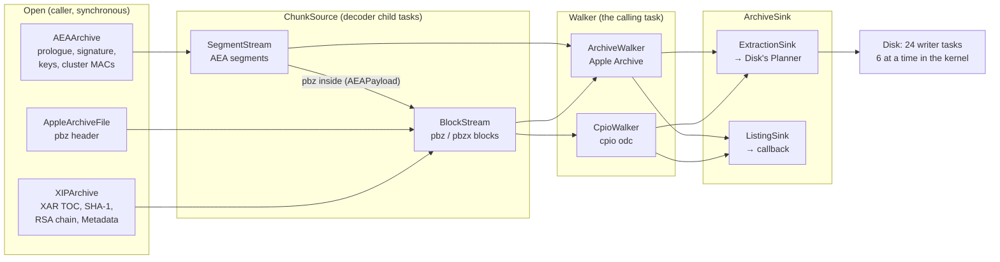
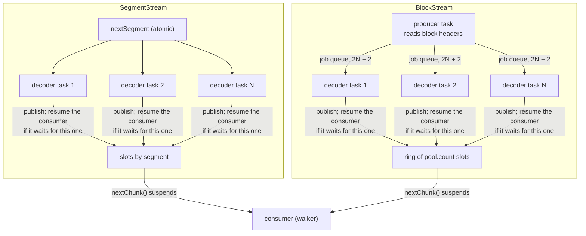
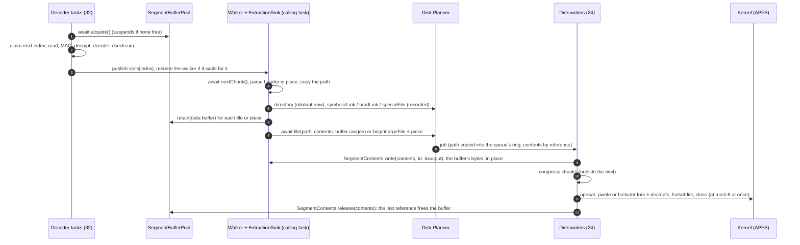
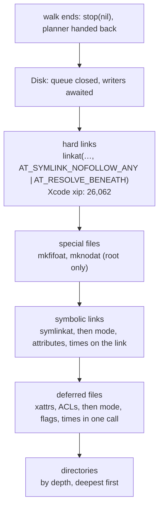
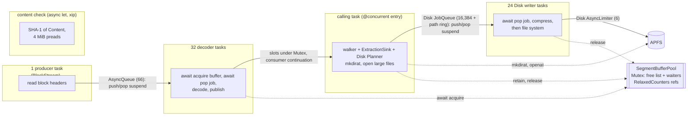

# How nunarchiver works

`nunarchiver` verifies, lists, decrypts, and extracts Apple Encrypted Archives (`.aea`), Apple Archives (`.aar`), and
Xcode's `.xip` files. One pipeline serves every format: a **chunk source** decodes the archive into a pool of large
buffers with many decoder tasks; one **walker**, on the calling task, parses the decoded stream in place; and a
**sink** turns entries into work. For extraction, that work is a plan for **Disk** (`../Disk`), whose **writer** tasks
compress outside a small file-system limit. Every part is a child task of the call (structured concurrency, no threads of its own):
cancelling the caller stops all of it. This document follows the code from the command line down to the system calls.
The byte formats are described in [FORMAT.md](FORMAT.md), and the measurements in [RESULTS.md](RESULTS.md) and
[XIP-REPORT.md](XIP-REPORT.md).

All paths below are under `NativeAEA/Sources/`. Numbers are from Xcode on an M3 Ultra (32 cores: 24 performance and
8 efficiency).

## Contents

1. [The command](#1-the-command)
2. [The shape of the pipeline](#2-the-shape-of-the-pipeline)
3. [Opening an archive](#3-opening-an-archive)
4. [Chunk sources: decoding in parallel](#4-chunk-sources-decoding-in-parallel)
5. [The buffer pool and its references](#5-the-buffer-pool-and-its-references)
6. [Walkers: parsing in place](#6-walkers-parsing-in-place)
7. [Extraction: the sink, the jobs, and the writers](#7-extraction-the-sink-the-jobs-and-the-writers)
8. [After the walk: links, metadata, directories](#8-after-the-walk-links-metadata-directories)
9. [Concurrency: every task, queue, and lock](#9-concurrency-every-task-queue-and-lock)
10. [Listing and decrypting](#10-listing-and-decrypting)
11. [Failure and cancellation](#11-failure-and-cancellation)

## 1. The command

`nunarchiver/NUnarchiver.swift` is an `AsyncParsableCommand` (swift-argument-parser). Its async main task runs at the
default priority, so `run()` starts one child task at `.userInitiated` (the QoS the pipeline's threads had; child tasks
inherit their parent's priority), whose `work()` reads the file's first four bytes and dispatches:

| Magic | Path | Opens |
|---|---|---|
| `xar!` | `runXIP()` | `XIPArchive(path:signature:)` |
| `AEA1` | `work()` itself | `AEAArchive(path:signingKey:decryptionKey:)` |
| anything else | `runAppleArchive()` | `AppleArchiveFile(path:)` (plain or `pbz` `.aar`) |

Each path then does one of three things:
- `--info` prints the header.
- `-d DIR` calls `extract(to:options:)`.
- `-o FILE` calls `decrypt(to:range:…)`, for AEA only.
- With none of those, it calls `forEachEntry(options:_:)` with `-l`, which verifies everything and lists the entries,
  or `verify(options:)` without, which verifies everything and makes no entries.

These (and `verify`) are `@concurrent … async throws(AEAError)`: one hop off the caller's actor on entry, one back on return.
Everything inside is `nonisolated(nonsending)`, so it stays on that one executor and internal calls make no executor
checks beyond the resumptions after real suspensions (§9). `forEachEntry`'s callback is a plain (non-`Sendable`)
closure, called on the calling task one entry at a time. Opening (`AEAArchive(path:…)`, `XIPArchive`,
`AppleArchiveFile`) stays synchronous: it reads only headers.

The options map one to one onto `AEAReadOptions`, which control decoding (decoders, input, checks), and
`AEAExtractionOptions`, which control writing (disk compression, overwriting, quarantine, and in `disk`, Disk's own
`ExtractionSettings`: writers, file-system width, progress, timings), mapped onto Disk's options (§7). Both are defined
in `NativeAEA/Listing.swift` and `NativeAEA/Extraction.swift`. `--decode-threads` and `--writer-threads` count child
tasks; the format comes from `ArchiveKind(detecting:)` (first bytes, then extension); `--hard-link-threads` and
`--spread-directories` went with the move to Disk (2026-11-20: both measured slower), and `--progress` draws the
extraction's progress.

`--fetch-key` (an IPSW's WKMS key) uses `URLSession.data(from:)`.

## 2. The shape of the pipeline



There are three abstractions, and each format plugs into them:

- **`ChunkSource`** (`SegmentStream.swift`):
  - `run() async` decodes with child tasks of its own and returns when they've all ended.
  - `prepare() async throws(AEAError)` is the consumer's first call; only `AEAPayload` (§4) does anything in it.
  - `nextChunk() async throws(AEAError) -> DecodedChunk?` returns chunks strictly in order. A `DecodedChunk` names a
    buffer in the pool and that chunk's position in the decoded stream (`rawOffset`, `rawSize`).
  - `stop(_ failure:)` (any thread, any number of times) and `releaseUnconsumed()` (after `run()` has returned).
  - `pool`, `pools` (every pool it decodes into, for leak checks), and `counters` (busy, read, and wait time).

  `withDecoding(onCancel:_:)` puts them together: one `DiscardingTaskGroup` holding `run()`, the consumer running in
  the group's body on the calling task (extraction runs Disk's writers there, as children of its own), then `stop(nil)`, the group waiting
  for every child, and `releaseUnconsumed()`. One `withTaskCancellationHandler` around it is the operation's only
  cancellation handler (§11).
- **A walker** (`ArchiveWalker`, `CpioWalker`): `walk(source, into: &sink) async` takes chunks in order and calls the
  sink for each entry's header, its data, and its metadata blobs, with pointers into the buffers.
- **`ArchiveSink`** (`ArchiveWalker.swift`): `entry(_:header:buffer:)`, `data(_:count:fileOffset:buffer:segment:)`,
  and `endEntry()` are `async` (extraction may wait there: room in Disk's write queue, a large-file slot);
  `metadata(_:_:count:offset:)` stays synchronous. `StreamFormat.walk` picks the walker, and
  `Extractor.extract` and `Lister.list` pick the sink. Each walker is specialized for each sink, and every sink method
  returns without suspending unless it must wait.

The cpio walker translates each cpio header into the Apple Archive model (`AAEntryHeader`). The extractor never
learns that an entry came from a xip, so xip support needed no changes to the writers. The xip-specific rules live
in `CpioWalker.entryHeader` (which files get `diskCompression = 8`, times, and hard-link clusters from `dev`/`ino`)
and in Disk's `StoragePolicy.lzvnForks` (PNGs skipped, `pays` in 4 KiB blocks, each LZVN chunk given its own size as
room), which `AFT` 8 maps to.

## 3. Opening an archive

Opening runs synchronously on the caller and reads only headers. The content is decoded later, by the chunk sources.

### `.aea`: `AEAArchive.init` (`AEAArchive.swift`)

1. **Prologue.** Read the fixed part, then the whole prologue (`AEAPrologue`): the profile, auth data, signature,
   key-exchange fields, the encrypted root header, and its MAC.
2. **Signer.** For signed profiles, `AEASignature.signer` finds the signer's P-256 key, either from the certificate
   chain in the auth data (checked against Apple's G3 root by `CertificateChain.verify`) or from a key given
   explicitly.
3. **Main key.** `AEAKeys.mainKey` derives it from the profile with HKDF-SHA256: a symmetric key, ECDH with a
   recipient key, scrypt from a password, or an HPKE-opened key for IPSWs (`WKMS.swift`). Then
   `AEASignature.verify` checks the ECDSA signature over the prologue.
4. **Root header.** Its MAC (HMAC-SHA256 under the `AEA_RHEK` key) is checked, then it's decrypted (AES-CTR with
   Apple's 64-bit big-endian counter) and parsed into `AEARootHeader`: segment size, total raw size, compression,
   checksum kind.
5. **Clusters.** Each cluster header is read, its MAC is checked against the value carried in the previous one
   (a chain starting at the prologue), and it's decrypted. The result is `segments: [AEASegment]`: each segment's
   file offset, stored and raw sizes, and raw offset, plus its checksum, its MAC, and its per-segment key
   (`AEA_SK`). Padding after the last segment is MACed too.

When `init` returns, every structure has been authenticated, and the segments' own MACs, decryption, decoding, and
checksums are left to the decoders.

### `.xip`: `XIPArchive.init` (`XIP.swift`, `XAR.swift`)

1. **Header and TOC.** Read the 28-byte `XARHeaderRecord` (a `@BinaryRecord` read with `AlignedBytesReader`).
   Inflate the TOC with Bytes' `DeflateDecoder(format: .zlib)`, and parse it with `XAR.parseTableOfContents`, a
   small streaming XML scanner, into `XARTableOfContents`: the checksum's place, the signature's place and
   certificates, `creation-time`, and the members.
2. **TOC checksum.** The SHA-1 of the compressed TOC must equal the heap's first 20 bytes, compared in constant
   time.
3. **Signature.** `verifySignature` builds `RSA.PublicKey(certificate:)` from the leaf certificate and checks the
   PKCS #1 v1.5 signature over the 20-byte checksum. Then `CertificateChain.verify(…, at: creationTime, policy:
   .softwareUpdate)` checks the chain: Software Update ← Apple Software Update Certification Authority ← Apple Root
   CA, pinned by SHA-256, with the software-update signing usage required on the leaf.
4. **Content.** Find the `Content` member, check that it's stored (`application/octet-stream`), and read its pbzx
   header to get the block size.
5. **Metadata.** `readMetadata` reads `Metadata`, checks its archived SHA-1, decodes it with Bytes'
   `BZip2Decoder`, checks its extracted SHA-1, and parses the property list into `XIPMetadata`.

### `.aar`: `AppleArchiveFile` (`Payload.swift`)

This only checks for a `pbz` header (`PBZ.compression`) or the `AA01`/`YAA1` magic, and records the block size.

## 4. Chunk sources: decoding in parallel

### Which source, and how they chain

| Archive | Source | Built in |
|---|---|---|
| `.aea` holding an Apple Archive | `AEAPayload` → its `SegmentStream` | `AEAArchive.payload` |
| `.aea` holding a `pbz` stream (IPSW images, `aa` with `-a`) | `AEAPayload` → `BlockStream(.upstream(SegmentStream))` | `AEAPayload.prepare`: it looks at the first decoded segment for a `pbz` header |
| `.aar`, plain | `BlockStream(.file, .plain(sliceSize:))` | `AppleArchiveFile.source` |
| `.aar`, `pbz` | `BlockStream(.file, .pbz(…))` | `AppleArchiveFile.source` |
| `.xip` | `BlockStream(.file(descriptor, start: contentStart, end: …), .pbz(.lzma, blockSize:))` | `XIPArchive.source` |



### `SegmentStream` (`SegmentStream.swift`)

AEA segments are all described up front, in `archive.segments`, so the decoders need no producer:

- **`run()`** adds `decoders` (default `activeProcessorCount`: 32) child tasks to a `DiscardingTaskGroup`, each
  running `decodeTask()`, and returns when they've all ended.
- **`decodeTask()`** makes its own `SegmentCodec` (decoder state allocated once per task) and read buffer, then
  loops: `await pool.acquire()` (suspending only when no buffer is free; `nil` once the pool is closed), then
  `decodeNext(into:…)`. It checks the stream's `cancelled` flag and `Task.isCancelled` once per segment.
  - **The order of those two steps prevents a deadlock.** A decoder takes a free buffer first and only then claims
    the next segment index (`nextSegment.add(1)`). A decoder holding a segment number therefore always has somewhere
    to put it, and the segment the walker waits for can never be starved by decoders that took later numbers and
    are waiting for buffers.
- **`decode(_:into:codec:readBuffer:)`** does one segment, synchronously:
  1. A positioned read into the task's read buffer (`AEAArchive.readFully`, `pread`), or a pointer into the
     mapping with `--input mapped` (Disk's `MappedFile`, read `.sequential`: `mmap` with `MADV_SEQUENTIAL`).
  2. `SegmentChecks.verifyMAC`: HMAC-SHA256 under the segment's key.
  3. For encrypted profiles, AES-CTR decryption, in place in the read buffer.
  4. `SegmentCodec.decode` into the pool buffer: Bytes' LZMA2/xz, LZFSE, LZBITMAP, LZ4, LZRAVEN, LZVN, or zlib
     decoder. (Compression's, once chosen with `--decoder system`, went 2026-11-22: the benchmarks keep it as a
     reference row.)
  5. `SegmentChecks.verifyChecksum`: SHA-256 or Murmur64 of the raw bytes, whichever the root header names (or
     none).

  A segment stored as is (stored size equal to its raw size; `aea -a copy`, or data that didn't compress) is read
  straight into the pool buffer instead, and MACed, decrypted in place, and checked there: the read buffer isn't
  touched (with `--input mapped` it's decrypted from the mapping into the pool buffer, or copied).
- **The read buffer** holds the largest stored segment (16 MiB for Xcode's). Its pages past the first 2 MiB are given
  back after every segment that used them (Bytes' `RawStorage.giveBack`, `madvise(MADV_FREE_REUSABLE)`) and taken back
  before the next (`reuse`, `MADV_FREE_REUSE`), so between segments a decoder keeps 2 MiB resident, not the largest
  segment it has seen. The kernel takes the pages only under memory pressure, so reusing them costs no faults
  otherwise. Segments of a large incompressible file come together, so 32 decoders can still hold 32 large segments
  at once: Xcode's `.aea` has 32 consecutive segments totalling 487 MiB stored.
- **Publishing:** under the stream's `Mutex<State>` (`slots`, one per segment, allocated once; the first failure; the
  consumer's continuation and the index it waits for) the decoder sets `slots[index] = buffer`; it takes the
  consumer's continuation only if the consumer waits for exactly this index, and resumes it after the lock.
- **`next(_:)`** (behind `nextChunk()`) takes the slot under the lock if it's published (no suspension), throws the
  first failure, or stores its continuation and suspends, checking again under the same lock so no publish is
  missed. The time spent in it is `counters.wait`. `peek()` waits the same way without taking the slot.

### `AEAPayload` (`Payload.swift`)

Whether an AEA archive's segments hold an Apple Archive or a `pbz` stream is known only from the first segment's
bytes. `AEAPayload` wraps the `SegmentStream`:

- **`run()`** starts the segments' decoders at once, then waits (a continuation) for the decision; for a `pbz` stream
  it then runs the block stream's producer and decoders in the same group.
- **`prepare()`** (the consumer's first call) `peek()`s the first segment, decoded in parallel with the others, reads
  its first 12 bytes, and decides: the segments themselves, or a `BlockStream(.upstream(segments))` sized from the
  `pbz` header. The first segment stays published, so the block stream's producer takes it as its first chunk: it's
  decoded once.
- **The segments' pool** is made before the decision, sized for writers holding segment buffers (the plain case:
  `decoders + extraBuffers + held + 1`), but only `decoders + extraBuffers + 2` of its buffers are handed out until
  then (`SegmentBufferPool(count:segmentCapacity:active:)`): what a `pbz` stream needs, since there the writers hold
  the block stream's buffers and the segments' only consumer is the block stream's producer, which holds one segment
  at a time. `prepare()` activates the rest (`activateAll()`: to waiting decoders first, then to the bottom of the free
  list) only when the segments hold the archive itself. A `pbz` stream's segments never touch the inactive buffers,
  whose pages never become resident: 369 MiB less for 16 MiB segments and 24 writers (a 1.1 GB `pbz` stream in
  stored segments: 2,892 → 2,003 MB peak extracting, with the stored segments' read path below). Limiting the pool at
  the decision instead was too late: stored segments decode so fast that the decoders, holding every thread, had
  touched all 65 buffers before the walker's task ran `prepare()`.
- `stop`, `releaseUnconsumed`, `pool`, and `counters` go to the block stream once there is one (it stops and releases
  its upstream too), to the segments otherwise; `stop` before the decision also ends `run()`'s wait.

Decoding the first segment on the caller's task before starting the decoders (the first design) cost every `.aea`
operation one segment's decoding time: listing Xcode's `.aea` took 2.82–2.87 s against 2.66–2.69 s without it.

### `BlockStream` (`BlockStream.swift`)

Block boundaries in `pbz` and pbzx streams are known only by reading each block's 16-byte header, so a
**producer** task reads them in sequence and queues jobs (`Job`: index, raw offset and size, stored size, and
either a file offset or a staging buffer):

- **From a file** (`produce(from: descriptor…)`): only the headers are read. Each decoder then `pread`s its own
  block: straight into the output buffer when the block is stored, or into its read buffer for decoding (whose pages
  past 2 MiB are given back after each block, as `SegmentStream`'s are).
- **From an upstream source** (`produce(from: upstream…)`, a `pbz` stream inside AEA segments): blocks cross
  segment boundaries freely, so the producer copies each block's stored bytes into a **staging pool** buffer
  through `UpstreamReader`, which takes upstream chunks with `nextChunk()` and releases them as it passes them.
- **The job queue** is BytesAsync's `AsyncQueue<Job>` with capacity `2 × decoders + 2`. Each decoder does `await pool.acquire()`,
  then `await jobs.pop()`: buffer first, then job, for the same reason as above. It decodes, releases the staging
  buffer, and publishes.
- **Slots** are a ring of `pool.count` entries, each carrying (index, buffer, raw offset, raw size), allocated once:
  block `i` goes in slot `i % pool.count`. Decoders take jobs in order, each holding a buffer until the block is
  consumed, so every block between the consumer's and a published one holds a buffer: at most `pool.count` are
  published at once, and none overwrites another.
- **`blockCount`** is set by the producer when it reaches the end (resuming the consumer if it waits past it).
  `nextChunk()` returns `nil` once it has taken that many.

For a xip, this means 32 decoders working through 617 blocks of 16 MiB, each block an xz stream decoded by
`LZMA2Decoder.decompressXZ`. Bytes' decoder takes 16% less time than Compression's here.

## 5. The buffer pool and its references

`SegmentBufferPool` (`Buffers.swift`, all that file holds now) is the one large allocation. It's a single `RawStorage`
(Bytes': page-aligned, allocated once) divided into `count` buffers. Each buffer is laid out as:

```
[ carry region: 64 KiB ][ chunk: up to segment/block size ][ 64 bytes slack ]   (rounded to 16 KiB)
```

- **Count:** `decoders + extraBuffers + held + 1`. Here `held` is the number of writers for extraction (each
  writer may hold one buffer through a job) and 0 for listing. For Xcode that's 32 + 8 + 24 + 1 = **65 buffers of
  16 MiB**, about 1.1 GB, most of the peak memory footprint: 1.21 GB extracting the xip, 1.37 GB the `.aea` (whose
  decoders' read buffers can hold 32 large stored segments at once, §4), 0.82 and 1.08 GB listing them. The `+ 1`
  ensures a decoder can always get a buffer while the consumer holds its own.
- **References:** `references`, BytesAsync's `RelaxedCounters`: one count per buffer, all in one allocation.
  - `acquire() async -> Int?` takes the last freed buffer under the pool's `Mutex` (free list, waiters, `closed`) and
    sets its count to 1; that reference belongs to the walker while it reads the chunk. With none free it stores its
    continuation in the waiter queue (checked again under the lock) and suspends. `tryAcquire()` never waits.
  - `retain(_:)` adds one reference per job that points into the buffer.
  - `release(_:)` subtracts with `.acquiringAndReleasing`. The last release hands the buffer straight to the task that
    has waited longest (one waiter per release, resumed after the lock), or puts it back on the free list.
  - `close()` stops handing buffers out: every waiter, and every later `acquire()`, gets `nil`. Releases still return
    buffers, so `buffersInUse` reaches 0 after a failure too.
- **The carry region** holds a header split across two chunks. The walker copies the partial header's first bytes
  just before the next chunk's bytes, so every header is contiguous in memory. File contents are never copied.
- **The slack** leaves room for 16-byte copy loops. (It also let Compression's decoders, when they were a choice, be
  asked for one byte more than expected, to detect a segment that decodes long; Bytes' decoders check the exact
  size and the input consumed instead.)

A buffer stays out of the pool until the walker has moved past it **and** every job pointing into it has been
written. This is how memory stays bounded: decoders suspend when the pool is empty, and the walker suspends when
decoders haven't caught up.

## 6. Walkers: parsing in place

Both walkers (`ArchiveWalker.walk`, `CpioWalker.walk`) are the same loop over chunks:

1. `await source.nextChunk()` returns the next buffer.
2. If the previous chunk ended inside a header (`carry > 0`), copy those bytes into the carry region before this
   chunk, then release the previous buffer. The walker holds at most two buffers.
3. Parse headers in place:
   - **Apple Archive:** `AppleArchive.headerByteCount`, then `parseHeader` into `AAEntryHeader`, which records
     offsets (`AAHeaderRange`) for the path, link target, and blobs, not copies.
   - **cpio:** `Cpio.parseHeader` reads the 76-byte octal header. The name, and a symbolic link's target, are kept
     contiguous with it. `entryHeader` converts it to an `AAEntryHeader`.
4. Call `await sink.entry(…)` with a pointer to the header in the buffer. Then, for each piece of the entry's blobs in
   this chunk, call `await sink.data(pointer, count:, fileOffset:, buffer:, segment:)` for contents, or
   `sink.metadata(…)` for extended attributes and ACLs. Call `await sink.endEntry()` when the entry's blobs are
   complete.
5. At the end of the stream, check that the walk ended between entries. cpio must also have seen `TRAILER!!!`.

A file's contents reach the sink as one or more pieces: one per chunk the contents overlap. A 16 MiB block holds
thousands of small files, and a large file spans many blocks.

## 7. Extraction: the sink, and Disk

Since 2026-11-20 the tree is written by **Disk** (`Disk/`, the disk-writing half of NativeAEA and NativeZipArchive,
extracted: [Disk/ARCHITECTURE.md](../Disk/ARCHITECTURE.md)). NativeAEA keeps what's about archives: decoding, walking,
and turning entries into a plan. Disk owns everything from the plan down: the planner, the write queue, the writers and
their file-system limit, APFS compression (`StoragePolicy`, the encoders, `decmpfs`), metadata (`EntryMetadata`,
extended attributes, ACLs, `Quarantine`), large files in pieces, and the passes after the writers.

`Extractor.extract` (`Extraction.swift`) makes the `Destination` (Disk: the directory made and opened once, every
entry made relative to it with `O_NOFOLLOW_ANY | O_RESOLVE_BENEATH`; the quarantine set on it first for an `.aar`),
then runs everything inside the source's task group (`withDecoding`): the decoders, and, once `prepare()` has told it
the pool, Disk's `Extraction.run`, whose plan closure is the walk:



### Setup

- `AEAExtractionOptions` maps onto Disk's options: `disk` is Disk's `ExtractionSettings` itself (`scheduling` only
  clamps its writers and width to at least 1), and `destination(quarantine:quarantinesDestination:)` gives the
  destination Apple's extractors' rules: `permissions: .exact` and `keepsSpecialBits` (the archived mode exactly),
  `overwrite` → `existingItems: .replace`, `restoresOwnership`, `relativeToParents` →
  `directoryResolution: .descriptors`, devices allowed (made as root, skipped and counted otherwise), and the archive's
  quarantine (`Quarantine(copyingFrom:)`) with `quarantinesDestination` for an `.aar` only.
- `DiskCompressionMode.storage(_:)` turns a file's `AFT` into Disk's `Storage`: `.archived` uses
  `StoragePolicy.forArchivedType` (LZBITMAP → `.appleArchive`, `aa extract`'s rules; LZVN → `.lzvnForks`,
  `xip --expand`'s, since the cpio walker asks for LZVN only over 16 KiB), `.lzfse` uses `.appleArchiveLZFSE`, `.none`
  is plain.
- After `await source.prepare()`, `Extraction.run(into:source:settings:_:)` starts the writers (24 child tasks) and runs
  the plan closure on the calling task. The closure moves Disk's `Planner` into an `ExtractionSink`, walks, stops the
  source (`stop(nil)`: no more chunks are taken), and hands the planner back, so Disk can run its passes after the
  writers.

### The contents: `SegmentContents`

Disk's writers ask a `ContentSource` for each file's bytes. `SegmentContents` (a `PieceSource`) names them by buffer
index and offset, at most two ranges (`Contents`, 48 bytes, copied into each queued job):
- `write(_:to:)` hands the writer the range in place (`FileOutput.write`, no copy), or two ranges for a small file
  across a chunk boundary (Disk gathers them in the writer's staging buffer);
- `release(_:)` drops the job's buffer references; `retain(_:)` adds one for a piece Disk keeps for a later piece's
  chunk (a bridge);
- `withPiece(_:_:)` gives a large file's piece as a `MutableRawSpan`, which Disk's writer compresses in place, over its
  own consumed input (no one else reads it: the walker reads only past it).

### The walker's side: `ExtractionSink`

`ExtractionSink` is a `~Copyable` struct on the walker's task holding Disk's `Planner` (also `~Copyable`), so neither
needs a lock. Per entry:

- **`entry(_:header:buffer:)`** copies the path into the sink's own storage (a file's data can arrive after the walker
  has released the header's buffer, when a header ends a chunk) and checks it as a Disk `EntryPath` (a vector screen,
  then the kernel's own checks on every call). Then, by type:
  - **Regular file:** the metadata (`EntryMetadata`: mode, owner, times, flags) and storage are noted; the file is
    planned when its data arrives. A file in a hard-link cluster is planned `hardLinked`, its `EntryToken` kept by
    cluster; a later name becomes `planner.hardLink(_:to:)`, its contents skipped.
  - **Directory:** `planner.directory`, which makes it at once (and any missing parents), so a file's parent always
    exists before the file is queued. Its final mode, times, and flags are applied after everything else. The root
    entry is left alone.
  - **Symbolic link, FIFO, device:** recorded by the planner and made after the writers (links last, so nothing is
    written through one).
- **`data(…)`** plans files, taking one buffer reference per job:
  - **Whole file in one chunk** (most files): `planner.file(…, contents: one range)`, which queues a job (suspending
    only while the queue's 16,384 jobs are full: `walkWaitForWriters`).
  - **Small file across a chunk boundary** (up to 1 MiB): the first range is `pending` until the second arrives, then
    one job with both.
  - **Large file:** `planner.beginLargeFile` on the first piece (Disk opens it there, so pieces can be written in any
    order; `minimumPieceSize` is the segment size, so a 64 KiB chunk spans at most 8 pieces), then `planner.piece` per
    chunk. Disk decides the fork from the first bytes and bridges pieces in which no chunk ends.
- **`metadata(…)`** gathers an entry's `XAT` and `ACL` blobs (they can come before its data); **`endEntry()`** plans an
  empty file, then adds the blobs to the entry (`addExtendedAttributes`, `addAccessControlList`): Disk applies them
  after the writers, then the mode, times, and flags.
- **`finish(walked:)`** releases a `pending` first range after a failure and, after a full walk, sets the progress's
  exact totals.

A large file's entry token (for its blobs and hard links to it) is Disk's `LargeFileToken.entry`.

### Progress

`AEAExtractionOptions.progress` is Disk's `ExtractionProgress`: one slot of relaxed atomics per writer, a relaxed add
per file (and per piece of a large file), polled by the app; nothing is published. The extraction sets the totals: at
the start, an estimate of the bytes (the `.aea` payload's raw size, an `.aar` file's size, a xip's cpio size from its
`Metadata`); when the walk has read the whole stream, which is long before the writers finish, the exact entries and
bytes. The `nunarchiver --progress` flag draws it twice a second.

### The writers (Disk)

Disk's `Writer`s (`Disk/Sources/Disk/Writer.swift`, `FileWriter.swift`) do what NativeAEA's did, with the same scratch
made once per writer and the same suspension points (a job, a file-system permit, a fork's turn). Per file: compress
first, outside the limit (inline in `com.apple.decmpfs` when it fits 3,584 bytes and the policy allows it, else a
resource fork of 64 KiB chunks if the policy says it pays, else plain), then inside it `openat` (`O_EXCL |
O_NOFOLLOW_ANY | O_RESOLVE_BENEATH`, owner-writable), `pwrite` or the fork and the `decmpfs` header, the quarantine,
**one `fsetattrlist`** with the times, mode, owner, and flags (`UF_COMPRESSED` included: in one call the times given
stick, where `fchflags` reset them), and `close`. That one call replaced `fchflags`, `fchmod`, and the times'
`fsetattrlist`: one call fewer per compressed file with times (the xip), and per file whose mode the umask changed.
Large files are written in pieces exactly as before (compressed in place, the fork written in order by turns, the
whole-fork decision at the end, a fork that doesn't pay rewritten plain): Disk/ARCHITECTURE.md §5.

### Why compression is outside the file-system limit

APFS file creation contends beyond a few threads. Measured on this machine, small-file creation peaks at about 4
threads and slows beyond 8, and the xip measured best at a width of 6 (4: 11.2 s; 8: 10.45 s; 12: 11.2–11.4 s).
Compression is CPU work that scales with cores. So 24 writers compress in parallel, and at most 6 are in the kernel
at once. On Xcode's xip, the writers' summed time was:
- 33.8 s waiting for the file system;
- 14.9 s compressing;
- 9.2 s in `open`;
- 3.9 s writing data;
- 3.3 s writing forks;
- 3.1 s setting flags and times;
- 1.6 s in `close`.

Apple's `aa extract`, which allows 32 threads in the kernel, spent 340 s of system time on the same archive.

## 8. After the walk: links, metadata, directories

When the walk ends, the plan closure stops the source (`stop(nil)`: decoders end at once after a failure) and returns
the planner; Disk closes its queue, waits for the writers, and runs its passes, each in `fileSystemWidth` lanes
(Disk/ARCHITECTURE.md §5, `PostPasses.swift`):



- **Hard links after the files**, only to files the plan wrote (`hardLink(_:to:)` takes the first name's
  `EntryToken`). Making them during the writes (NativeAEA's `--hard-link-threads`) measured 11% slower on the xip and
  went with the move.
- **Symbolic links after everything else**, so no file or hard link is ever created through one; every call refuses
  links in its path (`O_NOFOLLOW_ANY`, `AT_SYMLINK_NOFOLLOW_ANY`) and stays beneath the destination
  (`O_RESOLVE_BENEATH`).
- **Deferred files** (extended attributes, ACLs, or locking flags on a hard-linked file): left owner-writable with only
  `UF_COMPRESSED` by their writer; this pass applies the blobs, then the rest in one `fsetattrlist`.
- **Directories last, deepest first, one depth at a time**: their times are set after everything inside them, and a
  read-only mode never blocks a child. With only the quarantine to set, by path in one `setxattr`.

Two options, off by default (the command line's extractions stay `aa extract`'s and `xip --expand`'s, item for item),
are what the Nunarchiver app adds to match Archive Utility (RESULTS.md, 2026-11-21):

- `restoresDestinationMetadata`: the entry for the archive's root (the empty path; `aa archive -d DIR` writes one) is
  planned like any directory, so the directory pass gives the destination its mode, times, flags, and attributes. The
  sink otherwise skips it.
- `restoresXIPDirectoryTimes`: `CpioWalker` records a directory's time in its entry, and the sink drops it
  (`keepsDirectoryTimes`) unless this is set. Set, each of the xip's directories gets one more `fsetattrlist` in the
  directory pass, after the hard links that would otherwise change its time.

For an app that must ask for keys before it opens an archive, `AEAArchive.profile(at:)` reads the profile from the first
12 bytes with no key, and `AEASigningKey.publicKey(text:)` takes a signer's key as a field holds it.

## 9. Concurrency: every task, queue, and lock

There are no threads of the library's own: everything runs on Swift concurrency's cooperative pool (one thread per
core), as child tasks of the call. During a xip extraction on this machine there are 59 tasks: the calling task (the
walker), 32 decoders, 1 block producer, 24 writers, and 1 content checker (an `async let`).



| Primitive | Where | What it protects or signals |
|---|---|---|
| `DiscardingTaskGroup` | `ChunkSource.withDecoding`, `SegmentStream.run`, `BlockStream.run`, `AEAPayload.run`; Disk's `Extraction.run` and its passes' lanes | The operation's child tasks: decoders, the producer; Disk's writers and the lanes of each pass after the walk |
| `async let` | `XIPArchive.extract`, `forEachEntry` | The content check, cancelled if the extraction throws |
| `withTaskCancellationHandler` | `ChunkSource.withDecoding`; Disk's `Extraction.run` | Cancellation: stops the source; stops Disk's planner and writers (§11) |
| `Mutex` + continuations, waiters in a `WaiterQueue` reserved up front (BytesAsync) | `SegmentBufferPool`, `AsyncQueue` (the block stream's), `SegmentStream`/`BlockStream` slots, `AEAPayload` decision; Disk's queue, limiter, large-file slots and turns, latch | Free buffers; the block queue's ring; published chunks and the first failure; Disk: the write queue, file-system permits, whose turn it is to write a fork, writers ending |
| `Atomic<Int>` / `Atomic<Bool>` | `nextSegment`, `cancelled`, `peakInUse`, source counters; Disk's stop flag, `outstanding`, counters, `ExtractionProgress` slots | Claiming the next segment without a lock; stopping; counts read across tasks |
| `RelaxedCounters` (BytesAsync: N atomics in one allocation) | Pool `references` | One reference count per buffer |

### The primitives

All of them follow one pattern, and since 2026-11-21 share one implementation of its parts: BytesAsync's
`Continuation` and `withContinuation`, `WaiterQueue`, `AsyncQueue` (this package's block queue, moved there),
`AsyncLimiter`, `AsyncIndexPool`, and `AsyncLatch` (Disk's, moved there), and Bytes' `RawStorage`. What stays here is
what's this pipeline's own: `SegmentBufferPool` (its carry regions, reference counts, and activation), and the slot
rings of `SegmentStream` and `BlockStream`; Disk keeps its write queue (jobs plus a ring of path bytes, and a low-water
wake). The moves changed no count (RESULTS.md, 2026-11-21). The pattern:

- **A synchronous fast path under the lock.** `acquire`, `push`, `pop`, `waitForTurn`, and `next` take what they need
  under a `Mutex` and return without suspending when they can; a task suspends only where a thread used to block.
- **No lost wakeups.** The slow path stores its continuation in the same critical section that checks again, and the
  side that would wake it (a release, a push, a publish) looks for a waiter under the same lock.
- **One waiter per event, resumed outside the lock.** A released buffer, permit, or slot index goes straight to the
  task that has waited longest; a pushed job to a waiting consumer; a consumer taking from a full queue moves a waiting
  producer's job into the ring and resumes it; a publish resumes the consumer only if it waits for that index; a
  passed turn resumes only the next piece. Only closing (and a failed fork) resumes everyone.
- **Waiter storage reserved up front** (`WaiterQueue`, a ring that grows only past its capacity): the steady state
  allocates nothing. Release builds use `UnsafeContinuation` (in a `@safe` wrapper, `Continuation`); debug builds use
  `CheckedContinuation`, which checks every continuation is resumed once (it allocates a canary per wait, so release
  builds don't use it: Disk's writers wait for the file system about once per file).
- **Closing.** `SegmentBufferPool.close()` and `AsyncQueue.close()` resume every waiter (with `nil`, or `false` for a
  producer whose job wasn't added); the source's `stop` closes its pools and queue, so every decoder and producer
  ends without polling.

### Executors and priorities

- The public functions are `@concurrent`; everything inside is `nonisolated(nonsending)`, so the walker and its sink
  calls run on the entry's executor and child tasks on theirs, with no hops. Counted with LLDB on a 1,001-file
  archive: listing makes 312 `swift_task_switch` checks (6,222 before the internal functions were `nonsending`),
  extracting 1,467 (21,374), about one per real suspension; the Swift Concurrency instrument shows no thread switches
  inside the pipeline.
- The cooperative pool has one thread per core, and decoding a 16 MiB xz block takes about 100 ms with no suspension:
  32 decoders can hold every thread while the walker or a writer, just resumed, waits for one. Traced on the
  synthetic archive, the writers' first wakes waited up to 250 ms (median 25 µs); in the steady state the decoders are
  suspended on a full pool. The remedies were measured on Xcode's xip and `.aea` (interleaved with the threaded
  build): decoders yielding (`Task.yield()`) after every segment, or only after resuming the consumer, and decoders one
  priority below the walker and writers, made no difference beyond run-to-run noise, so decoders inherit the caller's
  priority and don't yield, and no custom executor is needed.
- A writer blocks its thread in file-system calls; at most `fileSystemWidth` (6) do at once.
- Stacks: cooperative threads have 512 KiB (the old threads had 1 MiB). The decoders' and writers' large state is in
  allocated storage (codecs, read buffers, `RawStorage` scratch); the largest stack values are path buffers of
  `PATH_MAX`. The xz paths (xip, Xcode's `.aea`) run in full.

### `Sendable`

The primitives hold only `Mutex` and `Atomic` state, so they're checked `Sendable` (`SegmentBufferPool`, `AEAPayload`,
BytesAsync's `AsyncQueue` and limits, and Disk's). Classes with fields only one task touches are `final class …: @unchecked Sendable`
(`SegmentStream` and `BlockStream`: the consumer's position; `RawStorage`). Their mutable state is in a `Mutex`, or is
touched by one task only (the consumer's position), as stated beside it. Values crossing tasks (`SegmentContents` and
its `Contents`, `Job`, `DecodedChunk`) are `Sendable` structs of integers and the pool's reference.

### Ordering guarantees, and how they're kept

- **Directories before their contents:** the planner makes them, in stream order, before queuing anything inside.
- **A large file exists before its pieces:** the planner opens it (`beginLargeFile`).
- **Fork pieces in order:** Disk's large-file turns. Compression runs before waiting for the turn.
- **A buffer outlives every pointer into it:** reference counts. The walker retains a buffer for each job (and Disk
  for each bridged piece) before queuing it, and the writer releases it once written (`SegmentContents.release`).
- **Hard links after their target:** made after the writers.
- **Times that stick:** one `fsetattrlist` sets `UF_COMPRESSED` and the times together (separately, `fchflags` set the
  modification time to now; NativeAEA used to order the calls).

### No allocations in the steady state

Every buffer is allocated once: the pool, each decoder's read buffer and codec state, each writer's scratch and
encoders (Disk's), the sink's path and blob buffers, the planner's arena (which grows only by amortized doubling), the
job and path rings, the slots, and the waiter queues. A file costs one job copied into Disk's ring slot and its path
into the path ring, and no heap allocation; a suspension allocates nothing in release builds. Child tasks are made once
per operation.
The Bytes codecs used here (xz, LZVN, LZBITMAP, LZFSE, bzip2) and RSA verification have zero-malloc benchmark
thresholds.

Checked by tracing every heap allocation of an extraction (2026-11-22: LLDB breakpoints on `swift_slowAlloc`, `malloc`,
`calloc`, and `realloc` printing backtraces, grouped by the first frame in this code; RESULTS.md has the method). The
synthetic archive (189 segments, 30,363 entries, 28 files over a segment) makes about 540 allocations in the pipeline,
none per file and none per segment: the pool and its reference counts, each decoder's task, read buffer, and LZMA state,
each writer's task, scratch, and encoder workspaces (made on first use), each task allocator's slabs as its async stack
first deepens, Disk's queue, context, and large-file slots, and the passes after the walk. Two per-data allocations were
found and removed: a heap box per segment for a local `var` pointer in `SegmentStream.decode` (assigned in branches and
borrowed by spans: now constants), and two arrays per bridged piece of a large file in Disk (now held in the job). The
rest of the process's ~2,800 are argument parsing, the runtime's metadata caches, and process start.

## 10. Listing and decrypting

- **Listing** (`forEachEntry`, `Lister.list`): the same source and walker, with `ListingSink`, in
  `withDecoding`. It creates `AAEntry` values for the callback and ignores contents. With no writers, `held` is 0.
  Every segment is still decoded and checked, so a listing is a full verification: 2.1 s for Xcode's xip, with 22.6
  cores busy.
- **Verifying** (`verify(options:)`, what `nunarchiver` does without `-l`, `-d`, or `-o`): the same, with no callback,
  so `ListingSink` makes no `AAEntry` and none of its strings (a path, and a link's target).
- **Decryption** (`AEAArchive.decrypt`, `Decrypt.swift`): a `SegmentStream` restricted to the segments that overlap
  the requested range, decoded by child tasks. The calling task writes each segment's overlap at its offset in order
  with `await next(index)` (Disk's `OutputFile.write(_:at:)`: positioned writes to the end), then releases it. The
  package makes no file-system call of its own for output now: trees through Disk's `Extraction`, this file through
  `OutputFile`. Input stays on swift-system's `FileDescriptor` (`AEAArchive.readFully`, one `pread` loop for every
  reader), or Disk's `MappedFile`.

## 11. Failure and cancellation

- **The first error wins.** A decoder that fails calls the stream's `stop(error)`: the failure is stored under the
  stream's lock, the waiting consumer is resumed and throws it, and the pool and queue are closed, so the other
  decoders end. A writer's failure stops Disk's extraction: writers skip remaining jobs (releasing their contents), a
  skipped large-file piece marks the file failed so no piece waits for its turn forever, and the planner's next call
  throws it, which the sink rethrows as an `AEAError` (`AEAError.init(_: DiskError)`: paths, file-system errors, and
  cancellation as before). A walk failure (a decoder's, a malformed stream) ends the plan with its own error, which
  `Extraction.run` reports as `.plan(error)` after stopping its writers.
- **Cancellation** has two handlers, one per layer: `withDecoding`'s stops the source with `.cancelled` (the consumer's
  wait ends with that error, the pools and job queue close, so decoders and the producer end; they also check
  `Task.isCancelled` once per segment or block), and Disk's `Extraction.run` stops its planner and writers (writers
  skip what's left, releasing its references; the planner's next call throws `.cancelled`).

  The walker then throws `.cancelled` from its next `nextChunk()` or entry. Disk's write queue isn't closed early: the
  writers drain it (skipping the work), so the walker's pushes land and every reference is released. Disk's passes
  after the walk check for cancellation per item, and the xip's content check per 4 MiB read.
- **After the tasks end, everything is released.** `withDecoding` releases published but unconsumed buffers (and a
  block stream's queued jobs' staging buffers) once its group has ended: no polling is needed, because closing the
  pool and the queues resumes every waiter, so the group simply ends. The tests check that `buffersInUse` (and
  `unreleasedBuffers`, summed over every pool) is 0 after successful, failed, and cancelled operations, and that a
  cancelled extraction or listing throws `.cancelled` promptly.
- **A pending file and an open large file** are released by the sink's `finish(walked:)` and Disk's planner (which
  closes and removes a large file left half-planned).
