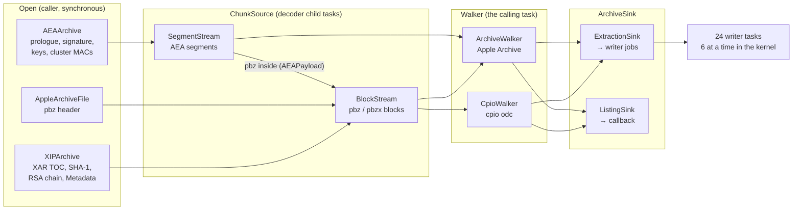
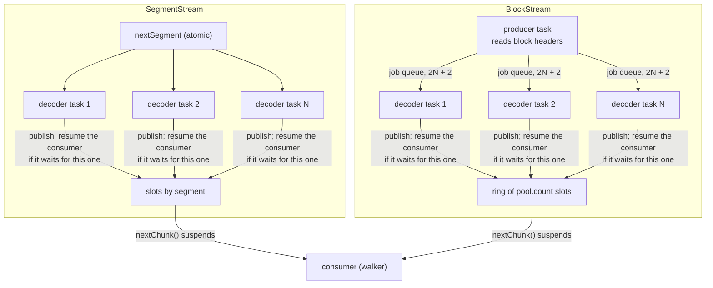
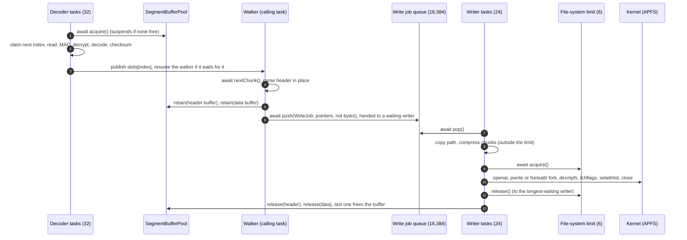
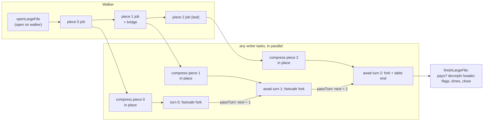
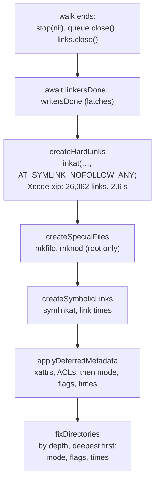
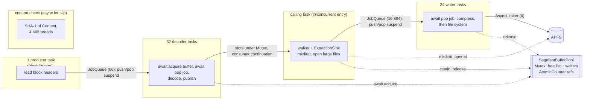

# How nunarchiver works

`nunarchiver` verifies, lists, decrypts, and extracts Apple Encrypted Archives (`.aea`), Apple Archives (`.aar`), and
Xcode's `.xip` files. One pipeline serves every format: a **chunk source** decodes the archive into a pool of large
buffers with many decoder tasks; one **walker**, on the calling task, parses the decoded stream in place; and a
**sink** turns entries into work. For extraction, that work is jobs for **writer** tasks, which compress outside a
small file-system limit. Every part is a child task of the call (structured concurrency, no threads of its own):
cancelling the caller stops all of it. This document follows the code from the command line down to the system calls.
The byte formats are described in [FORMAT.md](FORMAT.md), and the measurements in [RESULTS.md](RESULTS.md) and
[XIP-REPORT.md](XIP-REPORT.md).

All paths below are under `NativeAEA/Sources/`. Numbers are from Xcode on an M3 Ultra (32 cores: 24 performance and
8 efficiency).

## Contents

1. [The command](#1-the-command)
2. [The shape of the pipeline](#2-the-shape-of-the-pipeline)
3. [Opening an archive](#3-opening-an-archive)
4. [Chunk sources: decoding in parallel](#4-chunk-sources-decoding-in-parallel)
5. [The buffer pool and its references](#5-the-buffer-pool-and-its-references)
6. [Walkers: parsing in place](#6-walkers-parsing-in-place)
7. [Extraction: the sink, the jobs, and the writers](#7-extraction-the-sink-the-jobs-and-the-writers)
8. [After the walk: links, metadata, directories](#8-after-the-walk-links-metadata-directories)
9. [Concurrency: every task, queue, and lock](#9-concurrency-every-task-queue-and-lock)
10. [Listing and decrypting](#10-listing-and-decrypting)
11. [Failure and cancellation](#11-failure-and-cancellation)

## 1. The command

`nunarchiver/NUnarchiver.swift` is an `AsyncParsableCommand` (swift-argument-parser). Its async main task runs at the
default priority, so `run()` starts one child task at `.userInitiated` (the QoS the pipeline's threads had; child tasks
inherit their parent's priority), whose `work()` reads the file's first four bytes and dispatches:

| Magic | Path | Opens |
|---|---|---|
| `xar!` | `runXIP()` | `XIPArchive(path:signature:)` |
| `AEA1` | `work()` itself | `AEAArchive(path:signingKey:decryptionKey:)` |
| anything else | `runAppleArchive()` | `AppleArchiveFile(path:)` (plain or `pbz` `.aar`) |

Each path then does one of three things:
- `--info` prints the header.
- `-d DIR` calls `extract(to:options:)`.
- `-o FILE` calls `decrypt(to:range:…)`, for AEA only.
- With none of those, it calls `forEachEntry(options:_:)` with `-l`, which verifies everything and lists the entries,
  or `verify(options:)` without, which verifies everything and makes no entries.

These (and `verify`) are `@concurrent … async throws(AEAError)`: one hop off the caller's actor on entry, one back on return.
Everything inside is `nonisolated(nonsending)`, so it stays on that one executor and internal calls make no executor
checks beyond the resumptions after real suspensions (§9). `forEachEntry`'s callback is a plain (non-`Sendable`)
closure, called on the calling task one entry at a time. Opening (`AEAArchive(path:…)`, `XIPArchive`,
`AppleArchiveFile`) stays synchronous: it reads only headers.

The options map one to one onto `AEAReadOptions`, which control decoding (decoders, decoder, input, checks), and
`AEAExtractionOptions`, which control writing (writers, file-system width, disk compression, hard-link tasks, and so
on). Both are defined in `NativeAEA/Listing.swift` and `NativeAEA/Extraction.swift`. The option names (`decodeThreads`,
`writerThreads`, `hardLinkThreads`) and flags are unchanged; each now counts child tasks.

`--fetch-key` (an IPSW's WKMS key) uses `URLSession.data(from:)`.

## 2. The shape of the pipeline



There are three abstractions, and each format plugs into them:

- **`ChunkSource`** (`SegmentStream.swift`):
  - `run() async` decodes with child tasks of its own and returns when they've all ended.
  - `prepare() async throws(AEAError)` is the consumer's first call; only `AEAPayload` (§4) does anything in it.
  - `nextChunk() async throws(AEAError) -> DecodedChunk?` returns chunks strictly in order. A `DecodedChunk` names a
    buffer in the pool and that chunk's position in the decoded stream (`rawOffset`, `rawSize`).
  - `stop(_ failure:)` (any thread, any number of times) and `releaseUnconsumed()` (after `run()` has returned).
  - `pool`, `pools` (every pool it decodes into, for leak checks), and `counters` (busy, read, and wait time).

  `withDecoding(onCancel:_:)` puts them together: one `DiscardingTaskGroup` holding `run()`, the consumer running in
  the group's body on the calling task (it may add tasks of its own: the writers), then `stop(nil)`, the group waiting
  for every child, and `releaseUnconsumed()`. One `withTaskCancellationHandler` around it is the operation's only
  cancellation handler (§11).
- **A walker** (`ArchiveWalker`, `CpioWalker`): `walk(source, into: &sink) async` takes chunks in order and calls the
  sink for each entry's header, its data, and its metadata blobs, with pointers into the buffers.
- **`ArchiveSink`** (`ArchiveWalker.swift`): `entry(_:header:buffer:)`, `data(_:count:fileOffset:buffer:segment:)`,
  and `endEntry()` are `async` (extraction may wait there: room in the write queue, a large-file slot, room in the link
  queue); `metadata(_:_:count:offset:)` stays synchronous. `StreamFormat.walk` picks the walker, and
  `Extractor.extract` and `Lister.list` pick the sink. Each walker is specialized for each sink, and every sink method
  returns without suspending unless it must wait.

The cpio walker translates each cpio header into the Apple Archive model (`AAEntryHeader`). The extractor never
learns that an entry came from a xip, so xip support needed no changes to the writers. The xip-specific rules live
in `CpioWalker.entryHeader` (which files get `diskCompression = 8`, times, and hard-link clusters from `dev`/`ino`)
and in `Decmpfs` (`skips` for PNGs, `pays` in 4 KiB blocks, and the LZVN room in `ChunkEncoders.compress`).

## 3. Opening an archive

Opening runs synchronously on the caller and reads only headers. The content is decoded later, by the chunk sources.

### `.aea`: `AEAArchive.init` (`AEAArchive.swift`)

1. **Prologue.** Read the fixed part, then the whole prologue (`AEAPrologue`): the profile, auth data, signature,
   key-exchange fields, the encrypted root header, and its MAC.
2. **Signer.** For signed profiles, `AEASignature.signer` finds the signer's P-256 key, either from the certificate
   chain in the auth data (checked against Apple's G3 root by `CertificateChain.verify`) or from a key given
   explicitly.
3. **Main key.** `AEAKeys.mainKey` derives it from the profile with HKDF-SHA256: a symmetric key, ECDH with a
   recipient key, scrypt from a password, or an HPKE-opened key for IPSWs (`WKMS.swift`). Then
   `AEASignature.verify` checks the ECDSA signature over the prologue.
4. **Root header.** Its MAC (HMAC-SHA256 under the `AEA_RHEK` key) is checked, then it's decrypted (AES-CTR with
   Apple's 64-bit big-endian counter) and parsed into `AEARootHeader`: segment size, total raw size, compression,
   checksum kind.
5. **Clusters.** Each cluster header is read, its MAC is checked against the value carried in the previous one
   (a chain starting at the prologue), and it's decrypted. The result is `segments: [AEASegment]`: each segment's
   file offset, stored and raw sizes, and raw offset, plus its checksum, its MAC, and its per-segment key
   (`AEA_SK`). Padding after the last segment is MACed too.

When `init` returns, every structure has been authenticated, and the segments' own MACs, decryption, decoding, and
checksums are left to the decoders.

### `.xip`: `XIPArchive.init` (`XIP.swift`, `XAR.swift`)

1. **Header and TOC.** Read the 28-byte `XARHeaderRecord` (a `@BinaryRecord` read with `AlignedBytesReader`).
   Inflate the TOC with Bytes' `DeflateDecoder(format: .zlib)`, and parse it with `XAR.parseTableOfContents`, a
   small streaming XML scanner, into `XARTableOfContents`: the checksum's place, the signature's place and
   certificates, `creation-time`, and the members.
2. **TOC checksum.** The SHA-1 of the compressed TOC must equal the heap's first 20 bytes, compared in constant
   time.
3. **Signature.** `verifySignature` builds `RSA.PublicKey(certificate:)` from the leaf certificate and checks the
   PKCS #1 v1.5 signature over the 20-byte checksum. Then `CertificateChain.verify(…, at: creationTime, policy:
   .softwareUpdate)` checks the chain: Software Update ← Apple Software Update Certification Authority ← Apple Root
   CA, pinned by SHA-256, with the software-update signing usage required on the leaf.
4. **Content.** Find the `Content` member, check that it's stored (`application/octet-stream`), and read its pbzx
   header to get the block size.
5. **Metadata.** `readMetadata` reads `Metadata`, checks its archived SHA-1, decodes it with Bytes'
   `BZip2Decoder`, checks its extracted SHA-1, and parses the property list into `XIPMetadata`.

### `.aar`: `AppleArchiveFile` (`Payload.swift`)

This only checks for a `pbz` header (`PBZ.compression`) or the `AA01`/`YAA1` magic, and records the block size.

## 4. Chunk sources: decoding in parallel

### Which source, and how they chain

| Archive | Source | Built in |
|---|---|---|
| `.aea` holding an Apple Archive | `AEAPayload` → its `SegmentStream` | `AEAArchive.payload` |
| `.aea` holding a `pbz` stream (IPSW images, `aa` with `-a`) | `AEAPayload` → `BlockStream(.upstream(SegmentStream))` | `AEAPayload.prepare`: it looks at the first decoded segment for a `pbz` header |
| `.aar`, plain | `BlockStream(.file, .plain(sliceSize:))` | `AppleArchiveFile.source` |
| `.aar`, `pbz` | `BlockStream(.file, .pbz(…))` | `AppleArchiveFile.source` |
| `.xip` | `BlockStream(.file(descriptor, start: contentStart, end: …), .pbz(.lzma, blockSize:))` | `XIPArchive.source` |



### `SegmentStream` (`SegmentStream.swift`)

AEA segments are all described up front, in `archive.segments`, so the decoders need no producer:

- **`run()`** adds `decoders` (default `activeProcessorCount`: 32) child tasks to a `DiscardingTaskGroup`, each
  running `decodeTask()`, and returns when they've all ended.
- **`decodeTask()`** makes its own `SegmentCodec` (decoder state allocated once per task) and read buffer, then
  loops: `await pool.acquire()` (suspending only when no buffer is free; `nil` once the pool is closed), then
  `decodeNext(into:…)`. It checks the stream's `cancelled` flag and `Task.isCancelled` once per segment.
  - **The order of those two steps prevents a deadlock.** A decoder takes a free buffer first and only then claims
    the next segment index (`nextSegment.add(1)`). A decoder holding a segment number therefore always has somewhere
    to put it, and the segment the walker waits for can never be starved by decoders that took later numbers and
    are waiting for buffers.
- **`decode(_:into:codec:readBuffer:)`** does one segment, synchronously:
  1. A positioned read into the task's read buffer (`AEAArchive.readFully`, `pread`), or a pointer into the
     mapping with `--input mapped` (`RawMapping`, `mmap` with `MADV_SEQUENTIAL`).
  2. `SegmentChecks.verifyMAC`: HMAC-SHA256 under the segment's key.
  3. For encrypted profiles, AES-CTR decryption, in place in the read buffer.
  4. `SegmentCodec.decode` into the pool buffer: Bytes' LZMA2/xz, LZFSE, LZBITMAP, LZ4, LZRAVEN, or zlib decoder,
     or Compression's with `--decoder system`.
  5. `SegmentChecks.verifyChecksum`: SHA-256 or Murmur64 of the raw bytes, whichever the root header names (or
     none).

  A segment stored as is (stored size equal to its raw size; `aea -a copy`, or data that didn't compress) is read
  straight into the pool buffer instead, and MACed, decrypted in place, and checked there: the read buffer isn't
  touched (with `--input mapped` it's decrypted from the mapping into the pool buffer, or copied).
- **The read buffer** holds the largest stored segment (16 MiB for Xcode's). Its pages past the first 2 MiB are given
  back after every segment that used them (`RawStorage.giveBack`, `madvise(MADV_FREE_REUSABLE)`) and taken back
  before the next (`reuse`, `MADV_FREE_REUSE`), so between segments a decoder keeps 2 MiB resident, not the largest
  segment it has seen. The kernel takes the pages only under memory pressure, so reusing them costs no faults
  otherwise. Segments of a large incompressible file come together, so 32 decoders can still hold 32 large segments
  at once: Xcode's `.aea` has 32 consecutive segments totalling 487 MiB stored.
- **Publishing:** under the stream's `Mutex<State>` (`slots`, one per segment, allocated once; the first failure; the
  consumer's continuation and the index it waits for) the decoder sets `slots[index] = buffer`; it takes the
  consumer's continuation only if the consumer waits for exactly this index, and resumes it after the lock.
- **`next(_:)`** (behind `nextChunk()`) takes the slot under the lock if it's published (no suspension), throws the
  first failure, or stores its continuation and suspends, checking again under the same lock so no publish is
  missed. The time spent in it is `counters.wait`. `peek()` waits the same way without taking the slot.

### `AEAPayload` (`Payload.swift`)

Whether an AEA archive's segments hold an Apple Archive or a `pbz` stream is known only from the first segment's
bytes. `AEAPayload` wraps the `SegmentStream`:

- **`run()`** starts the segments' decoders at once, then waits (a continuation) for the decision; for a `pbz` stream
  it then runs the block stream's producer and decoders in the same group.
- **`prepare()`** (the consumer's first call) `peek()`s the first segment, decoded in parallel with the others, reads
  its first 12 bytes, and decides: the segments themselves, or a `BlockStream(.upstream(segments))` sized from the
  `pbz` header. The first segment stays published, so the block stream's producer takes it as its first chunk: it's
  decoded once.
- **The segments' pool** is made before the decision, sized for writers holding segment buffers (the plain case:
  `decoders + extraBuffers + held + 1`), but only `decoders + extraBuffers + 2` of its buffers are handed out until
  then (`SegmentBufferPool(count:segmentCapacity:active:)`): what a `pbz` stream needs, since there the writers hold
  the block stream's buffers and the segments' only consumer is the block stream's producer, which holds one segment
  at a time. `prepare()` activates the rest (`activateAll()`: to waiting decoders first, then to the bottom of the free
  list) only when the segments hold the archive itself. A `pbz` stream's segments never touch the inactive buffers,
  whose pages never become resident: 369 MiB less for 16 MiB segments and 24 writers (a 1.1 GB `pbz` stream in
  stored segments: 2,892 → 2,003 MB peak extracting, with the stored segments' read path below). Limiting the pool at
  the decision instead was too late: stored segments decode so fast that the decoders, holding every thread, had
  touched all 65 buffers before the walker's task ran `prepare()`.
- `stop`, `releaseUnconsumed`, `pool`, and `counters` go to the block stream once there is one (it stops and releases
  its upstream too), to the segments otherwise; `stop` before the decision also ends `run()`'s wait.

Decoding the first segment on the caller's task before starting the decoders (the first design) cost every `.aea`
operation one segment's decoding time: listing Xcode's `.aea` took 2.82–2.87 s against 2.66–2.69 s without it.

### `BlockStream` (`BlockStream.swift`)

Block boundaries in `pbz` and pbzx streams are known only by reading each block's 16-byte header, so a
**producer** task reads them in sequence and queues jobs (`Job`: index, raw offset and size, stored size, and
either a file offset or a staging buffer):

- **From a file** (`produce(from: descriptor…)`): only the headers are read. Each decoder then `pread`s its own
  block: straight into the output buffer when the block is stored, or into its read buffer for decoding (whose pages
  past 2 MiB are given back after each block, as `SegmentStream`'s are).
- **From an upstream source** (`produce(from: upstream…)`, a `pbz` stream inside AEA segments): blocks cross
  segment boundaries freely, so the producer copies each block's stored bytes into a **staging pool** buffer
  through `UpstreamReader`, which takes upstream chunks with `nextChunk()` and releases them as it passes them.
- **The job queue** is a `JobQueue<Job>` with capacity `2 × decoders + 2`. Each decoder does `await pool.acquire()`,
  then `await jobs.pop()`: buffer first, then job, for the same reason as above. It decodes, releases the staging
  buffer, and publishes.
- **Slots** are a ring of `pool.count` entries, each carrying (index, buffer, raw offset, raw size), allocated once:
  block `i` goes in slot `i % pool.count`. Decoders take jobs in order, each holding a buffer until the block is
  consumed, so every block between the consumer's and a published one holds a buffer: at most `pool.count` are
  published at once, and none overwrites another.
- **`blockCount`** is set by the producer when it reaches the end (resuming the consumer if it waits past it).
  `nextChunk()` returns `nil` once it has taken that many.

For a xip, this means 32 decoders working through 617 blocks of 16 MiB, each block an xz stream decoded by
`LZMA2Decoder.decompressXZ`. Bytes' decoder takes 16% less time than Compression's here.

## 5. The buffer pool and its references

`SegmentBufferPool` (`Buffers.swift`) is the one large allocation. It's a single `RawStorage` (page-aligned,
allocated once) divided into `count` buffers. Each buffer is laid out as:

```
[ carry region: 64 KiB ][ chunk: up to segment/block size ][ 64 bytes slack ]   (rounded to 16 KiB)
```

- **Count:** `decoders + extraBuffers + held + 1`. Here `held` is the number of writers for extraction (each
  writer may hold one buffer through a job) and 0 for listing. For Xcode that's 32 + 8 + 24 + 1 = **65 buffers of
  16 MiB**, about 1.1 GB, most of the peak memory footprint: 1.21 GB extracting the xip, 1.37 GB the `.aea` (whose
  decoders' read buffers can hold 32 large stored segments at once, §4), 0.82 and 1.08 GB listing them. The `+ 1`
  ensures a decoder can always get a buffer while the consumer holds its own.
- **References:** `references: [AtomicCounter]`, one per buffer.
  - `acquire() async -> Int?` takes the last freed buffer under the pool's `Mutex` (free list, waiters, `closed`) and
    sets its count to 1; that reference belongs to the walker while it reads the chunk. With none free it stores its
    continuation in the waiter queue (checked again under the lock) and suspends. `tryAcquire()` never waits.
  - `retain(_:)` adds one reference per job that points into the buffer.
  - `release(_:)` subtracts with `.acquiringAndReleasing`. The last release hands the buffer straight to the task that
    has waited longest (one waiter per release, resumed after the lock), or puts it back on the free list.
  - `close()` stops handing buffers out: every waiter, and every later `acquire()`, gets `nil`. Releases still return
    buffers, so `buffersInUse` reaches 0 after a failure too.
- **The carry region** holds a header split across two chunks. The walker copies the partial header's first bytes
  just before the next chunk's bytes, so every header is contiguous in memory. File contents are never copied.
- **The slack** lets Compression's decoders be asked for one byte more than expected, which detects a segment that
  decodes long, and leaves room for 16-byte copy loops.

A buffer stays out of the pool until the walker has moved past it **and** every job pointing into it has been
written. This is how memory stays bounded: decoders suspend when the pool is empty, and the walker suspends when
decoders haven't caught up.

## 6. Walkers: parsing in place

Both walkers (`ArchiveWalker.walk`, `CpioWalker.walk`) are the same loop over chunks:

1. `await source.nextChunk()` returns the next buffer.
2. If the previous chunk ended inside a header (`carry > 0`), copy those bytes into the carry region before this
   chunk, then release the previous buffer. The walker holds at most two buffers.
3. Parse headers in place:
   - **Apple Archive:** `AppleArchive.headerByteCount`, then `parseHeader` into `AAEntryHeader`, which records
     offsets (`AAHeaderRange`) for the path, link target, and blobs, not copies.
   - **cpio:** `Cpio.parseHeader` reads the 76-byte octal header. The name, and a symbolic link's target, are kept
     contiguous with it. `entryHeader` converts it to an `AAEntryHeader`.
4. Call `await sink.entry(…)` with a pointer to the header in the buffer. Then, for each piece of the entry's blobs in
   this chunk, call `await sink.data(pointer, count:, fileOffset:, buffer:, segment:)` for contents, or
   `sink.metadata(…)` for extended attributes and ACLs. Call `await sink.endEntry()` when the entry's blobs are
   complete.
5. At the end of the stream, check that the walk ended between entries. cpio must also have seen `TRAILER!!!`.

A file's contents reach the sink as one or more pieces: one per chunk the contents overlap. A 16 MiB block holds
thousands of small files, and a large file spans many blocks.

## 7. Extraction: the sink, the jobs, and the writers

`Extractor.extract` (`Extraction.swift`) creates the destination, then runs everything in the source's task group
(`withDecoding`): the decoders, then (once `prepare()` has told it the pool) the writers and link tasks as further
children, the walk on the calling task, and, once the writers are done, the passes after the walk:



### Setup

- Create and open the destination (`O_DIRECTORY`), and raise the descriptor limit
  (`DirectoryTable.raiseDescriptorLimit`).
- In the group, after `await source.prepare()`, `ExtractionContext` holds what the walker and writers share:
  - `queue` (`JobQueue<WriteJob>`, capacity 16,384; a `WriteJob` is 312 bytes, so its ring is 5.1 MB, written when
    it's made);
  - `links` (`JobQueue<EarlyLink>`, capacity 4,096, for the link tasks; an `EarlyLink` holds two 1 KiB names, so the
    ring is 8.7 MB: capacity 1 when there are no link tasks, the default);
  - `fileSystem` (`AsyncLimiter`, 6 permits), or one limiter of one permit per lane with `--spread-directories`;
  - 128 `LargeFile` states and an `AsyncIndexPool` of their slots;
  - `failure` (`Mutex`), with a `failed` `Atomic` flag;
  - `timings` (`WorkTimings`, atomic nanosecond counters per kind of work).
- Add `writerThreads` (24) child tasks, each running `Writer(context).run()`, and `hardLinkThreads` (0 by default)
  link tasks running `EarlyLink.run`. Each counts down an `AsyncLatch` when it ends.

### The walker's side: `ExtractionSink`

`ExtractionSink` is a `~Copyable` struct that lives on the walker's task. It owns everything only the walker
touches, so none of it needs a lock:

- `directories`: a `DirectoryTable`, an open-addressing hash from path to descriptor, used with
  `--relative-to-parents`.
- `metadataBytes` and `linkBytes`: append-only arenas for paths and blobs, so entries cause no per-entry
  allocations.
- `deferred`: the entries finished after the writers.
- `hardLinkTargets` and `hardLinks`.
- `directoryFixes`: each directory whose mode, flags, times, or metadata need setting after the walk, its path in
  `metadataBytes` (no allocation per directory).
- `diskCompression`: files counted by `AFT` type in a 16-entry table, made into the statistics' dictionary at the end
  (no hashing per file).

Per entry:

- **`entry(_:header:buffer:)`** checks the path, then switches on the type. `Paths.check` rejects `..`
  components, empty components (so absolute paths too), NUL bytes, and paths of `PATH_MAX` or longer.
  - **Regular file:** record the parent (`directories.resolve`; by default, the destination plus the whole path)
    and the lane. A file in a hard-link cluster records its first name; a later name becomes a `HardLink` (pushed to
    the link tasks with `--hard-link-threads`), and its contents are skipped (`skipContents`). A file with extended
    attributes or an ACL is also recorded in `deferred`.
  - **Directory:** `makeDirectory` calls `mkdirat` with the mode `| 0700`, so its contents can be created in it.
    If the mode, flags, times, or metadata differ from what `mkdir` gave, it's queued in `directoryFixes`.
    Directories are created **by the walker, in order**, so a file's parent always exists before the file's
    job is queued.
  - **Symbolic link:** the path and target are appended to `linkBytes`. Links are made last (§8), so no file is
    ever written through one.
  - **FIFOs and devices:** deferred.
- **`data(…)`** decides the jobs. A job is a `WriteJob` value, which points into buffers and never copies bytes:
  - **Whole file in one chunk** (most files): retain the header and data buffers, and push one `.file` job.
  - **Small file across a chunk boundary** (up to `smallSpanLimit`, 1 MiB): keep the first range `pending`, then
    push one job with both ranges when the second arrives. The writer copies the two ranges into its `staging`
    buffer.
  - **Large file:** on its first piece, `openLargeFile` takes a `LargeFile` slot (`await`, suspending only when all
    128 are held), copies the path, decides the fork type, and **opens the file on the walker's task**, so pieces can
    then be written in any order. Each piece becomes a `.piece` job. When compressing, a piece in which no 64 KiB chunk
    ends gets no job: its buffer is retained in a `Bridge` (up to 8 pieces) and travels with the job of the piece that
    completes the chunk.
- **`endEntry()`** pushes a job for an empty file.
- **`enqueue(_:)`** awaits `queue.push`, which suspends only when the queue is full (`walkWaitForWriters`), and
  counts `pushed`, which lets early hard links know when their file's job has been taken.

### The writers' side: `Writer` (`Writer.swift`)

`Writer` is a `~Copyable` struct, one per writer task. All of its scratch memory is allocated once:
- a path buffer;
- compressed output for a batch of 16 chunks;
- a chunk table;
- a bridge chunk;
- a staging buffer;
- its own `ChunkEncoders` (Bytes' LZBITMAP, LZFSE, and LZVN encoders, whose tables are made once).

A writer suspends only where a thread used to block: for a job, for a file-system permit, and for a fork's turn.
Compression and the file-system calls run synchronously.

**`run()`** loops on `await queue.pop()` until the queue is closed and empty. For each job it calls `writeFile` or
`writePiece`, then releases the job's references: path buffer, data buffer, bridge, and second range.

**`writeFile`**, for a whole file:

1. Copy the path into the path buffer and add a NUL.
2. **Compress before entering the file system.** `Decmpfs.codec(job.diskCompression)` gives the codec; type 8 is
   LZVN for xips, and 13 or 14 is LZBITMAP for `aa`. `Decmpfs.skips` rules out PNGs for LZVN. `prepare` returns a
   `Form`:
   - **`.inline`:** one chunk that fits the 3,584-byte `com.apple.decmpfs` attribute (LZBITMAP and LZFSE only;
     `xip` never stores files inline).
   - **`.fork`:** up to 16 chunks. The chunk table and the chunks are laid out contiguously for one write, if
     `Decmpfs.pays` approves.
   - **`.streamed`:** more than 16 chunks, compressed and written a batch at a time.
   - **`.plain`:** compression didn't pay.

   `ChunkEncoders.compress` gives each LZVN chunk its own size as room, and LZBITMAP 64 KiB, which is what makes the
   stored bytes identical to Apple's. A chunk that doesn't shrink is stored raw behind a marker byte.
3. **Inside `await fileSystem { }`**, which takes a permit of the lane's `AsyncLimiter` (suspending when all are taken)
   and returns it after the synchronous body:
   1. `openat(directory, name, O_WRONLY | O_CREAT | O_EXCL | O_NOFOLLOW_ANY, mode | 0600)` (`Writer.create`).
   2. `pwrite` the data, or `fsetxattr` the resource fork and the 16-byte `com.apple.decmpfs` header.
   3. `complete`:
      - the quarantine attribute, if the archive has one;
      - then `finishAttributes`, in order: `fchown`, `fchmod`, `fchflags` (which sets `UF_COMPRESSED`, and resets
        the modification time), then the times through `fsetattrlist`, then any locking flags.
   4. `close`.

**`writePiece`**, for one piece of a large file:

- **Uncompressed:** one `pwrite` at the piece's offset, in any order.
- **Compressed:** pieces must go into the resource fork in order, but they're compressed in parallel first. Each
  chunk is compressed into a scratch slot and moved back **over the piece's own consumed input** in the pool buffer,
  while the output stays behind the unread input. No other job reads those bytes, so a piece needs no memory of its
  own. The writer then waits for its turn (`await LargeFile.waitForTurn(piece)`, which returns the fork offset to
  write at), writes its chunks and its table entries at the fork offset with `fsetxattr(…, position:)`, and passes the
  turn on (`passTurn(forkOffset:)`, which resumes the next piece only if it's already waiting).
- **The last reference** to a large file's `outstanding` atomic (pieces plus the walker's hold) runs
  `Writer.finishLargeFile`. It decides `pays` on the whole fork, rewrites the file plain through a `ForkUnpacker` if
  compression didn't pay, sets the decmpfs header and the attributes, closes the file, and frees the slot.



### Why compression is outside the file-system limit

APFS file creation contends beyond a few threads. Measured on this machine, small-file creation peaks at about 4
threads and slows beyond 8, and the xip measured best at a width of 6 (4: 11.2 s; 8: 10.45 s; 12: 11.2–11.4 s).
Compression is CPU work that scales with cores. So 24 writers compress in parallel, and at most 6 are in the kernel
at once. On Xcode's xip, the writers' summed time was:
- 33.8 s waiting for the file system;
- 14.9 s compressing;
- 9.2 s in `open`;
- 3.9 s writing data;
- 3.3 s writing forks;
- 3.1 s setting flags and times;
- 1.6 s in `close`.

Apple's `aa extract`, which allows 32 threads in the kernel, spent 340 s of system time on the same archive.

## 8. After the walk: links, metadata, directories

When the walk ends, the walker (still in the group's body, still under the cancellation handler):

1. Stops the source (`stop(nil)`: decoders end at once after a failure), closes `queue` and `links`, and awaits the
   link tasks' latch, then the writers' (`linkersAfterWalk`, `writersAfterWalk`).
2. Throws the first failure, if any, and collects links that early link tasks couldn't make yet (`lateLinks`).
3. Runs the remaining phases, each a `DiscardingTaskGroup` of `fileSystemWidth` lane tasks (`inLanes`), where each
   lane takes every `lanes`-th item and checks `Task.isCancelled` per item. The lanes' work is synchronous
   file-system calls; each lane borrows the arenas (`withUnsafeBytes` inside its own task: the arrays are complete,
   and captured without copying).



- **Hard links after the files:** a link can only be made once its target exists. Links made during the writes
  (`--hard-link-threads N`, `EarlyLink`) measured 11% slower on the xip, so they're off by default. A link task
  suspends in `queue.waitUntilPopped(after)` until the writers have taken its file's job (resumed by the pop that
  reaches it), then retries `ENOENT` for up to 50 ms with `Task.sleep(200 µs)` between tries (no event says when a
  writer has created a file).
- **Symbolic links after everything else**, so no file or hard link is ever created through one. All creation calls
  also refuse to follow links: `O_NOFOLLOW_ANY` and `AT_SYMLINK_NOFOLLOW_ANY`.
- **Deferred metadata** covers files that need more than the writers did: extended attributes, ACLs, or flags that
  would block hard links. Their writers left them owner-writable, with only `UF_COMPRESSED` set; this pass applies
  the blobs from the arena, then the final mode, flags, and times.
- **Directories last, deepest first, one depth at a time.** Each directory's times are set after everything inside
  it has been created, and a directory's read-only mode never blocks a child.

## 9. Concurrency: every task, queue, and lock

There are no threads of the library's own: everything runs on Swift concurrency's cooperative pool (one thread per
core), as child tasks of the call. During a xip extraction on this machine there are 59 tasks: the calling task (the
walker), 32 decoders, 1 block producer, 24 writers, and 1 content checker (an `async let`).



| Primitive | Where | What it protects or signals |
|---|---|---|
| `DiscardingTaskGroup` | `ChunkSource.withDecoding`, `SegmentStream.run`, `BlockStream.run`, `AEAPayload.run`, `ExtractionSink.inLanes` | The operation's child tasks: decoders, the producer, writers, link tasks; the lanes of each pass after the walk |
| `async let` | `XIPArchive.extract`, `forEachEntry` | The content check, cancelled if the extraction throws |
| `withTaskCancellationHandler` | `ChunkSource.withDecoding` (one per operation) | Cancellation: stops the source and fails the extraction (§11) |
| `Mutex` + continuations, waiters in a `WaiterQueue` reserved up front | `SegmentBufferPool`, `JobQueue`, `AsyncLimiter`, `AsyncIndexPool`, `AsyncLatch`, `LargeFile` turns, `SegmentStream`/`BlockStream` slots, `AEAPayload` decision | Free buffers; queue rings; file-system permits; large-file slots and fork unpackers; writers and link tasks ending; whose turn it is to write a fork; published chunks and the first failure |
| `Mutex` | `failure`, `lateLinks`, `FirstFailure` per pass, `CancellationTarget` | Small shared lists and the first error |
| `Atomic<Int>` / `Atomic<Bool>` | `nextSegment`, `cancelled`, `failed`, `outstanding`, timing counters, `peakInUse` | Claiming the next segment without a lock; stopping; counts read across tasks |
| `AtomicCounter` (a class around `Atomic`, so arrays can hold them) | Pool `references` | One reference count per buffer |

### The primitives

All of them follow one pattern (`Buffers.swift`):

- **A synchronous fast path under the lock.** `acquire`, `push`, `pop`, `waitForTurn`, and `next` take what they need
  under a `Mutex` and return without suspending when they can; a task suspends only where a thread used to block.
- **No lost wakeups.** The slow path stores its continuation in the same critical section that checks again, and the
  side that would wake it (a release, a push, a publish) looks for a waiter under the same lock.
- **One waiter per event, resumed outside the lock.** A released buffer, permit, or slot index goes straight to the
  task that has waited longest; a pushed job to a waiting consumer; a consumer taking from a full queue moves a waiting
  producer's job into the ring and resumes it; a publish resumes the consumer only if it waits for that index; a
  passed turn resumes only the next piece. Only closing (and a failed fork) resumes everyone.
- **Waiter storage reserved up front** (`WaiterQueue`, a ring that grows only past its capacity): the steady state
  allocates nothing. Release builds use `UnsafeContinuation` (in a `@safe` wrapper, `Continuation`); debug builds use
  `CheckedContinuation`, which checks every continuation is resumed once (it allocates a canary per wait, so release
  builds don't use it: writers wait for the file system about once per file).
- **Closing.** `SegmentBufferPool.close()` and `JobQueue.close()` resume every waiter (with `nil`, or `false` for a
  producer whose job wasn't added); the source's `stop` closes its pools and queue, so every decoder and producer
  ends without polling.

### Executors and priorities

- The public functions are `@concurrent`; everything inside is `nonisolated(nonsending)`, so the walker and its sink
  calls run on the entry's executor and child tasks on theirs, with no hops. Counted with LLDB on a 1,001-file
  archive: listing makes 312 `swift_task_switch` checks (6,222 before the internal functions were `nonsending`),
  extracting 1,467 (21,374), about one per real suspension; the Swift Concurrency instrument shows no thread switches
  inside the pipeline.
- The cooperative pool has one thread per core, and decoding a 16 MiB xz block takes about 100 ms with no suspension:
  32 decoders can hold every thread while the walker or a writer, just resumed, waits for one. Traced on the
  synthetic archive, the writers' first wakes waited up to 250 ms (median 25 µs); in the steady state the decoders are
  suspended on a full pool. The remedies were measured on Xcode's xip and `.aea` (interleaved with the threaded
  build): decoders yielding (`Task.yield()`) after every segment, or only after resuming the consumer, and decoders one
  priority below the walker and writers, made no difference beyond run-to-run noise, so decoders inherit the caller's
  priority and don't yield, and no custom executor is needed.
- A writer blocks its thread in file-system calls; at most `fileSystemWidth` (6) do at once.
- Stacks: cooperative threads have 512 KiB (the old threads had 1 MiB). The decoders' and writers' large state is in
  allocated storage (codecs, read buffers, `RawStorage` scratch); the largest stack values are `EarlyLink`'s two
  1 KiB names. The xz paths (xip, Xcode's `.aea`) run in full.

### `Sendable`

The primitives hold only `Mutex` and `Atomic` state, so they're checked `Sendable` (`SegmentBufferPool`, `JobQueue`,
`AsyncLimiter`, `AsyncIndexPool`, `AsyncLatch`, `FirstFailure`, `CancellationTarget`, `AEAPayload`). Classes with
fields only one task touches are `final class …: @unchecked Sendable` (`SegmentStream` and `BlockStream`: the
consumer's position; `ExtractionContext`, `LargeFile`: fields the walker sets before queuing a job; `RawStorage`). Their mutable
state is in a `Mutex`, or is touched by one task only (the consumer's position), as stated beside it. Values crossing tasks (`WriteJob`, `Bridge`, `Job`, `DecodedChunk`, `EarlyLink`) are `Sendable`
structs of integers. The passes after the walk capture the arenas (`[UInt8]`) by value, and each lane task borrows
their bytes with `withUnsafeBytes` around its synchronous loop.

### Ordering guarantees, and how they're kept

- **Directories before their contents:** the walker makes them, in stream order, before queuing anything inside.
- **A large file exists before its pieces:** the walker opens it.
- **Fork pieces in order:** `LargeFile`'s turn (`next`, `forkOffset`). Compression runs before waiting for the turn.
- **A buffer outlives every pointer into it:** reference counts. The walker retains a buffer for each job before
  pushing it, and the writer releases after writing.
- **Hard links after their target:** made after the writers' latch, or by early link tasks that wait for
  `popped >= job + 2` and retry on `ENOENT`.
- **Flags before times:** `finishAttributes` sets times after `fchflags`, because `UF_COMPRESSED` resets the
  modification time.

### No allocations in the steady state

Every buffer is allocated once: the pool, each decoder's read buffer and codec state, each writer's scratch and
encoders, the walker's arenas (which grow only by amortized doubling), the job rings, the slots, and the waiter
queues. A file costs one `WriteJob` copied into a ring slot (or handed to a waiting writer through its continuation),
and no heap allocation; a suspension allocates nothing in release builds. Child tasks are made once per operation.
The Bytes codecs used here (xz, LZVN, LZBITMAP, LZFSE, bzip2) and RSA verification have zero-malloc benchmark
thresholds.

## 10. Listing and decrypting

- **Listing** (`forEachEntry`, `Lister.list`): the same source and walker, with `ListingSink`, in
  `withDecoding`. It creates `AAEntry` values for the callback and ignores contents. With no writers, `held` is 0.
  Every segment is still decoded and checked, so a listing is a full verification: 2.1 s for Xcode's xip, with 22.6
  cores busy.
- **Verifying** (`verify(options:)`, what `nunarchiver` does without `-l`, `-d`, or `-o`): the same, with no callback,
  so `ListingSink` makes no `AAEntry` and none of its strings (a path, and a link's target).
- **Decryption** (`AEAArchive.decrypt`, `Decrypt.swift`): a `SegmentStream` restricted to the segments that overlap
  the requested range, decoded by child tasks. The calling task `pwrite`s each segment's overlap in order with
  `await next(index)`, then releases it.

## 11. Failure and cancellation

- **The first error wins.** A decoder that fails calls the stream's `stop(error)`: the failure is stored under the
  stream's lock, the waiting consumer is resumed and throws it, and the pool and queue are closed, so the other
  decoders end. Writers store theirs in `context.failure` and set `failed`; the walker checks that at each entry
  (`checkFailure`), and writers skip remaining jobs. A skipped large-file piece marks the file failed
  (`failTurns`), resuming any piece waiting for its turn, so no writer waits forever.
- **Cancellation** has one handler per operation, around its task group (`withDecoding`'s
  `withTaskCancellationHandler`). It runs synchronously in whoever cancels, and:
  - fails the extraction context with `.cancelled` (through `CancellationTarget`, which fails the context as soon as
    it exists if the cancellation came first), so writers skip what's left, releasing its references, and link tasks
    stop waiting;
  - stops the source with `.cancelled`: the consumer's wait ends with that error, and the pools and job queue close,
    so decoders and the producer end (they also check `Task.isCancelled` once per segment or block).

  The walker then throws `.cancelled` from its next `nextChunk()` or entry. The write queue isn't closed early: the
  writers drain it (skipping the work), so the walker's pushes land and every reference is released. The passes after
  the walk check `Task.isCancelled` per item, and the xip's content check per 4 MiB read.
- **After the tasks end, everything is released.** `withDecoding` releases published but unconsumed buffers (and a
  block stream's queued jobs' staging buffers) once its group has ended: no polling is needed, because closing the
  pool and the queues resumes every waiter, so the group simply ends. The tests check that `buffersInUse` (and
  `unreleasedBuffers`, summed over every pool) is 0 after successful, failed, and cancelled operations, and that a
  cancelled extraction or listing throws `.cancelled` promptly.
- **A pending file and an open large file** are released by `abandonOpenFile`.
